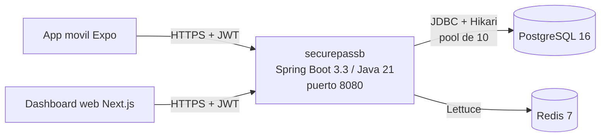

# Arquitectura

Vista de despliegue de `securepassb`. El diseno funcional y el modelo de
datos estan en `spec.md`; aca solo lo que importa para operar.

## Componentes



| Pieza | Para que | Si se cae |
|---|---|---|
| PostgreSQL 16 | Datos de negocio y bitacora de accesos (inmutable por trigger) | La app no arranca; en runtime los requests fallan a los 10 s |
| Redis 7 | Refresh tokens, anti-replay de QR, rate limit | Se pierden sesiones (hay que volver a loguearse); no hay perdida de datos de negocio |

## Base de datos

- **Motor:** PostgreSQL 16. Persistencia con `JdbcClient` (parametros
  nombrados) y dos entidades JPA (`LotEntity`, `NeighborhoodEntity`).
- **Esquema:** solo Flyway (`src/main/resources/db/migration`, V1 a V24).
  Hibernate corre con `ddl-auto: validate`: verifica que las entidades
  coincidan con las tablas, nunca crea ni borra nada.
- **IDs:** UUID generados por la base (`DEFAULT gen_random_uuid()`).
  V1 ejecuta `CREATE EXTENSION pgcrypto`: en Azure Database for PostgreSQL
  hay que habilitarla antes (parametro `azure.extensions`), o Flyway falla.
- **Credenciales:** `DB_URL`, `DB_USER`, `DB_PASSWORD` por variable de
  entorno. En `dev` tienen defaults de localhost; en `prod`
  (`application-prod.yml`) son obligatorias.

## HikariCP

Configurado en `src/main/resources/application.yml` (`spring.datasource.hikari`).

| Parametro | Valor | Por que |
|---|---|---|
| `maximum-pool-size` | 10 (`DB_POOL_MAX`) | El limite de exports concurrentes (2) se calculo como ~20% de este pool. Postgres B1ms de Azure: `max_connections` 50 con 15 reservadas = 35 utilizables (verificado). 10 por replica deja margen |
| `minimum-idle` | 2 | Pocas conexiones ociosas; la app escala a cero en Azure |
| `connection-timeout` | 10 s | Si el pool se agota o la base no responde, el request falla en 10 s en vez de 30 s |
| `keepalive-time` | 2 min | El NAT de salida de Azure corta conexiones TCP ociosas a los 4 min |
| `idle-timeout` / `max-lifetime` | 10 min / 30 min | Defaults de Hikari, explicitos |

Verificacion (perfil `prod` contra la base local, 2026-10-11):

```
log:      securepassb-pool - Added connection org.postgresql.jdbc.PgConnection
metricas: hikaricp.connections.max=10  min=2  idle=2  active=0  timeout=0
```

Metricas del pool: `GET /actuator/metrics/hikaricp.connections.active`
(requiere token de `PLATFORM_ADMIN`). `hikaricp.connections.timeout` mayor a
cero significa que hubo requests esperando conexion y fallaron: subir el pool
o buscar la consulta lenta.

## Perfiles

| Perfil | Activacion | Diferencias |
|---|---|---|
| (ninguno) / `dev` | default / `SPRING_PROFILES_ACTIVE=dev` | Defaults de localhost, logs de texto. `dev` habilita los seeds |
| `prod` | `SPRING_PROFILES_ACTIVE=prod` | `DB_*` y `REDIS_HOST` obligatorias, logs JSON (`logback-spring.xml`) |

Sintomas de configuracion faltante en `prod`:

| Falta | Que se ve en el log al arrancar |
|---|---|
| `DB_URL` | `URL must start with 'jdbc'` y la app termina |
| `DB_USER` / `DB_PASSWORD` | `password authentication failed for user` y la app termina |
| `SECUREPASS_JWT_SECRET` / `SECUREPASS_MASTER_KEY` | `Could not resolve placeholder` y la app termina |
| `REDIS_HOST` | La app arranca, `Unable to connect to ${REDIS_HOST}`; login da 500 y readiness `DOWN` |

## Health checks

| Endpoint | Incluye | Uso |
|---|---|---|
| `/actuator/health/liveness` | Estado interno de la app | Si falla, el orquestador reinicia el contenedor |
| `/actuator/health/readiness` | Estado interno + PostgreSQL + Redis | Si falla, el orquestador deja de mandarle trafico, sin reiniciar |
| `/actuator/health` | Todo | Vista general |

Verificado con el jar en perfil `prod` (2026-10-11):

| Escenario | liveness | readiness |
|---|---|---|
| Postgres y Redis arriba | 200 UP | 200 UP |
| Sin Redis | 200 UP | 503 DOWN |
| Postgres detenido en caliente | 200 UP | 503 DOWN |
| Postgres vuelve | 200 UP | 200 UP (Hikari reconecta solo) |

## Integracion con la app movil (Fase 15)

La app (`acr-securepassf/mobile`, Expo SDK 57, development build
`com.mengaasteam.securepass`) toma la URL del backend de
`EXPO_PUBLIC_API_URL` (`mobile/src/modules/auth/data.ts`), que Expo
inlinea al empaquetar. No hubo cambios de codigo en la app: solo
`mobile/.env` (ignorado por git):

```
EXPO_PUBLIC_API_URL=https://securepassb.proudbush-b955ebd5.eastus.azurecontainerapps.io
EXPO_PUBLIC_GATE_ID=66c14791-ffd5-44df-bbbc-3081a43501ee   # garita del Barrio Demo UM en Azure
```

- Desarrollo local: `EXPO_PUBLIC_API_URL=http://<IP de la PC>:8080`.
  Despues de cambiarla: `npx expo start --dev-client --clear`.
- HTTPS: Azure pone el certificado; Android no necesita permitir trafico en
  texto plano.
- JWT: el access token y el refresh token se guardan en `expo-secure-store`
  (Keystore de Android); el cliente agrega `Authorization: Bearer` y ante un
  401 intenta el refresh (`mobile/src/common/api/client.ts`).
- CORS no aplica a la app nativa (solo al dashboard web en el navegador).

### Correrlo en el emulador

```powershell
& "$env:LOCALAPPDATA\Android\Sdk\emulator\emulator.exe" -avd Pixel_8 -no-snapshot   # arranque en frio (~50 s)
cd ..\acr-securepassf\mobile
npx expo start --dev-client
& "$env:LOCALAPPDATA\Android\Sdk\platform-tools\adb.exe" reverse tcp:8081 tcp:8081
& "$env:LOCALAPPDATA\Android\Sdk\platform-tools\adb.exe" shell am start -a android.intent.action.VIEW -d "exp+securepass://expo-development-client/?url=http%3A%2F%2Flocalhost%3A8081"
```

Si el emulador queda con la pantalla negra y `adb shell` no responde, es el
snapshot de quickboot: cerrarlo y arrancar con `-no-snapshot`.

### Usuarios de prueba en Azure

Creados con los flujos de la app (no con SQL): el barrio con
`provisionNeighborhood`; el lote `A-01`, el titular y el guardia con
`POST /api/v1/admin/lots` y `POST /api/v1/admin/users` como el admin;
cuentas activadas con `POST /api/v1/activation/{token}`.

| Rol | Email | Password |
|---|---|---|
| Admin (web) | `admin@demo-um.example` | `AZ_ADMIN_PASSWORD` en `azure-secrets.env` |
| Guardia (app) | `guardia@demo-um.example` | `AZ_GUARD_PASSWORD` |
| Titular A-01 (app) | `titular@demo-um.example` | `AZ_OWNER_PASSWORD` |

### Verificacion (2026-10-12, backend `v1.1.0`)

En el emulador, contra Azure:

| Paso | Resultado en la app | Request en Application Insights |
|---|---|---|
| Abrir la app con la sesion vieja del backend local | "Tu sesion expiro" | `GET /api/v1/invitations 401`, `POST /api/v1/auth/refresh 401` |
| Login del guardia | Pantalla "No hay turno abierto" | `POST /api/v1/auth/login 200` (596 ms) + sincronizacion offline: `access/keys`, `access/permissions/sync`, `access/revoked`, `stays/open` |
| Abrir turno con nota | "Turno abierto - Nota de entrada: Prueba desde Azure" | `POST /api/v1/shifts/open 201` |
| Salir | Vuelve al login | `POST /api/v1/auth/logout 204` |
| Login del titular | "Invitaciones - Titular Demo" | `POST /api/v1/auth/login 200`, `GET /api/v1/invitations 200` |
| Mi QR | QR "Barrio Demo UM - Lote A-01" | `GET /api/v1/me/passes 200`: Azure descifro la clave Ed25519 del barrio con la master key de produccion y firmo el pase |

La camara del emulador no puede escanear la pantalla, asi que el escaneo de
la garita se hizo por API con el token del guardia:

| Prueba | Resultado |
|---|---|
| QR del titular | `ALLOWED` |
| El mismo QR con la firma alterada | `DENIED`, `INVALID_SIGNATURE` |
| El titular intentando validar | 403 (solo `GUARD`) |
| Bitacora (como admin) | `IN ALLOWED A-01` y `IN DENIED INVALID_SIGNATURE` registrados |
