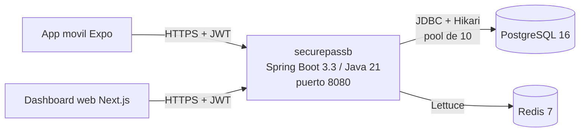

# Arquitectura

Vista de despliegue de `securepassb`. El diseno funcional y el modelo de
datos estan en `spec.md`; aca solo lo que importa para operar.

## Componentes



| Pieza | Para que | Si se cae |
|---|---|---|
| PostgreSQL 16 | Datos de negocio y bitacora de accesos (inmutable por trigger) | La app no arranca; en runtime los requests fallan a los 10 s |
| Redis 7 | Refresh tokens, anti-replay de QR, rate limit | Se pierden sesiones (hay que volver a loguearse); no hay perdida de datos de negocio |

## Base de datos

- **Motor:** PostgreSQL 16. Persistencia con `JdbcClient` (parametros
  nombrados) y dos entidades JPA (`LotEntity`, `NeighborhoodEntity`).
- **Esquema:** solo Flyway (`src/main/resources/db/migration`, V1 a V24).
  Hibernate corre con `ddl-auto: validate`: verifica que las entidades
  coincidan con las tablas, nunca crea ni borra nada.
- **IDs:** UUID generados por la base (`DEFAULT gen_random_uuid()`).
  V1 ejecuta `CREATE EXTENSION pgcrypto`: en Azure Database for PostgreSQL
  hay que habilitarla antes (parametro `azure.extensions`), o Flyway falla.
- **Credenciales:** `DB_URL`, `DB_USER`, `DB_PASSWORD` por variable de
  entorno. En `dev` tienen defaults de localhost; en `prod`
  (`application-prod.yml`) son obligatorias.

## HikariCP

Configurado en `src/main/resources/application.yml` (`spring.datasource.hikari`).

| Parametro | Valor | Por que |
|---|---|---|
| `maximum-pool-size` | 10 (`DB_POOL_MAX`) | El limite de exports concurrentes (2) se calculo como ~20% de este pool. Postgres B1MS de Azure admite ~50 conexiones (algunas reservadas): 10 por replica deja margen |
| `minimum-idle` | 2 | Pocas conexiones ociosas; la app escala a cero en Azure |
| `connection-timeout` | 10 s | Si el pool se agota o la base no responde, el request falla en 10 s en vez de 30 s |
| `keepalive-time` | 2 min | El NAT de salida de Azure corta conexiones TCP ociosas a los 4 min |
| `idle-timeout` / `max-lifetime` | 10 min / 30 min | Defaults de Hikari, explicitos |

Verificacion (perfil `prod` contra la base local, 2026-10-11):

```
log:      securepassb-pool - Added connection org.postgresql.jdbc.PgConnection
metricas: hikaricp.connections.max=10  min=2  idle=2  active=0  timeout=0
```

Metricas del pool: `GET /actuator/metrics/hikaricp.connections.active`
(requiere token de `PLATFORM_ADMIN`). `hikaricp.connections.timeout` mayor a
cero significa que hubo requests esperando conexion y fallaron: subir el pool
o buscar la consulta lenta.

## Perfiles

| Perfil | Activacion | Diferencias |
|---|---|---|
| (ninguno) / `dev` | default / `SPRING_PROFILES_ACTIVE=dev` | Defaults de localhost, logs de texto. `dev` habilita los seeds |
| `prod` | `SPRING_PROFILES_ACTIVE=prod` | `DB_*` y `REDIS_HOST` obligatorias, logs JSON (`logback-spring.xml`) |

Sintomas de configuracion faltante en `prod`:

| Falta | Que se ve en el log al arrancar |
|---|---|
| `DB_URL` | `URL must start with 'jdbc'` y la app termina |
| `DB_USER` / `DB_PASSWORD` | `password authentication failed for user` y la app termina |
| `SECUREPASS_JWT_SECRET` / `SECUREPASS_MASTER_KEY` | `Could not resolve placeholder` y la app termina |
| `REDIS_HOST` | La app arranca, `Unable to connect to ${REDIS_HOST}`; login da 500 y readiness `DOWN` |

## Health checks

| Endpoint | Incluye | Uso |
|---|---|---|
| `/actuator/health/liveness` | Estado interno de la app | Si falla, el orquestador reinicia el contenedor |
| `/actuator/health/readiness` | Estado interno + PostgreSQL + Redis | Si falla, el orquestador deja de mandarle trafico, sin reiniciar |
| `/actuator/health` | Todo | Vista general |

Verificado con el jar en perfil `prod` (2026-10-11):

| Escenario | liveness | readiness |
|---|---|---|
| Postgres y Redis arriba | 200 UP | 200 UP |
| Sin Redis | 200 UP | 503 DOWN |
| Postgres detenido en caliente | 200 UP | 503 DOWN |
| Postgres vuelve | 200 UP | 200 UP (Hikari reconecta solo) |
