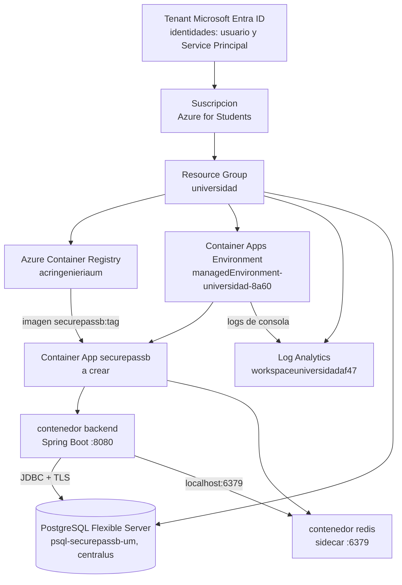

# Azure

Infraestructura de `securepassb` en Microsoft Azure: que recursos usa, por
que, cuanto cuestan y como se crean, verifican y eliminan.

> Los valores reales de IDs y secretos no se escriben aca. Se muestran
> abreviados (`bf8523b9...`) o como placeholders (`<NOMBRE>`).

## Jerarquia de recursos



- **Suscripcion**: el contrato de facturacion. Todo recurso vive en una.
- **Resource Group**: carpeta logica dentro de la suscripcion. Permisos,
  costos y borrado se pueden manejar por grupo.
- **ACR**: registro privado de imagenes Docker (como Docker Hub, pero
  nuestro). El CI publica ahi; Container Apps descarga de ahi.
- **Container Apps Environment**: el "cluster" administrado donde corren las
  Container Apps; comparte red y destino de logs.
- **Container App**: la aplicacion en si: imagen, CPU/memoria, variables,
  secretos, ingreso HTTPS, escalado y revisiones.

## Relevamiento de lo existente (2026-10-11, solo lectura)

| Recurso | Nombre | Estado | Decision |
|---|---|---|---|
| Suscripcion | Azure for Students (`bf8523b9...`) | Enabled. Sin tarjeta: al agotar el credito los recursos se deshabilitan, no se cobra | Usar |
| Resource Group | `universidad` (eastus) | Existe | Reutilizar |
| ACR | `acringenieriaum.azurecr.io` | SKU Standard, admin habilitado, 9,5 MB usados de 100 GB. Repos: `app-azure`, `1` | Reutilizar, repositorio nuevo `securepassb`. Bajado a Basic (ver Ahorros) |
| Container Apps Environment | `managedEnvironment-universidad-8a60` | Perfil Consumption, sin VNet, logs a Log Analytics, dominio `proudbush-b955ebd5.eastus.azurecontainerapps.io` | Reutilizar |
| Container App | `app-azure` (Go de la cursada) | Stopped (no consume) | No se toca |
| Log Analytics | `workspaceuniversidadaf47` | PerGB2018, retencion 30 dias, **sin tope diario** | Reutilizar, con tope diario (ver Ahorros) |
| PostgreSQL | `psql-securepassb-um` | Creado en la Fase 7 (ver abajo) | Usar |
| Redis | - | No existe | Sidecar dentro de la Container App |
| Key Vault | - | No existe, proveedor no registrado | No se usa (ver abajo) |
| Service Principal | appId `542811c2...` | `Contributor` sobre `universidad`, `Reader` sobre la suscripcion | Reutilizar (Fase 8) |

Proveedores de recursos de la suscripcion: `Microsoft.App`,
`Microsoft.ContainerRegistry` y `Microsoft.OperationalInsights` registrados;
`Microsoft.DBforPostgreSQL` no estaba registrado: lo registro el duenio de la suscripcion (paso manual 2).

### Hallazgo: Postgres restringido en eastus y eastus2

```
az postgres flexible-server list-skus -l eastus2
"reason": "Subscriptions are restricted from provisioning in this region..."
```

Azure for Students bloquea Postgres en algunas regiones. Ojo: con el
proveedor `Microsoft.DBforPostgreSQL` sin registrar, la consulta devuelve
datos incompletos y una region bloqueada parece libre. Ya registrado, el
relevamiento real fue:

| Region | Postgres B1ms + PG 16 |
|---|---|
| eastus, eastus2, southcentralus, westus2, canadaeast | Bloqueada |
| **centralus**, northcentralus, westcentralus, westus, westus3, canadacentral, brazilsouth | Disponible |

Se eligio **`centralus`**: la mas cercana al environment de Container Apps
(`eastus`), ~20-25 ms de latencia. El costo no cambia con la region. Si la
latencia molestara, se puede crear un environment de Container Apps en
`centralus` (gratis) y mover la app.

## Recursos a crear y costo

Precios aproximados en USD, region Central US. Todo sale del credito de
Azure for Students; ninguno cobra plata real.

| Recurso | Para que | Hace falta? | Costo | Como no gastar | Como eliminar |
|---|---|---|---|---|---|
| PostgreSQL Flexible Server B1ms, 32 GB, PG 16 | Base de datos de produccion | Si: el backend no arranca sin base | Gratis 12 meses dentro del cupo de servicios gratuitos (750 h/mes de B1ms + 32 GB), confirmado en Free services. Fuera del cupo ~13 USD/mes de computo + ~4 USD/mes de disco | Elegir exactamente B1ms y 32 GB, sin alta disponibilidad, sin backup geo-redundante. Se puede detener (`az postgres flexible-server stop`) hasta 7 dias | `az postgres flexible-server delete -g universidad -n <NOMBRE_PG>` (borra los datos) |
| Container App `securepassb` (backend + Redis sidecar) | Correr el backend | Si | Cupo gratis mensual por suscripcion: 180.000 vCPU-s, 360.000 GiB-s, 2 M requests. Con escala a cero el uso normal entra en el cupo. Encendida 24/7 con 0,75 vCPU / 1,5 GiB ~15 USD/mes | `min-replicas 0`; subir a 1 solo para la demo | `az containerapp delete -g universidad -n securepassb` |
| Repositorio `securepassb` en el ACR | Guardar las imagenes versionadas | Si | Incluido en el SKU del ACR | Borrar tags viejos | `az acr repository delete -n acringenieriaum --repository securepassb` |

### Recursos existentes que hoy gastan credito

| Recurso | Costo | Recomendacion |
|---|---|---|
| ACR **Standard** | ~0,67 USD/dia (~20 USD/mes) aunque no se use | Bajar a **Basic** (~5 USD/mes): 10 GB alcanzan (hoy hay 9,5 MB). Reversible: `az acr update -n acringenieriaum --sku Standard` |
| Log Analytics sin tope | Los primeros 5 GB/mes son gratis; despues ~2,3 USD/GB | Tope diario de 0,15 GB (~4,5 GB/mes): si se alcanza, se deja de ingerir hasta el dia siguiente |

### Por que Redis va como sidecar

Un sidecar es un segundo contenedor dentro de la misma Container App. El
backend lo ve en `localhost:6379`, sin red ni ingreso TCP que configurar, y
no es un recurso aparte: no suma costo fijo. Azure Cache for Redis costaria
~16 USD/mes.

Limites aceptados:
- Redis no tiene disco: si la app escala a cero o se reinicia, se pierden los
  refresh tokens (los usuarios vuelven a loguearse) y los contadores de rate
  limit. No se pierden datos de negocio: esos estan en Postgres.
- `max-replicas 1`: con dos replicas cada una tendria su propio Redis y no
  compartirian sesiones. Para un TP alcanza; para escalar, Redis pasa a ser
  un servicio aparte.

### Por que no Key Vault (por ahora)

Los secretos de una Container App ya se guardan cifrados y se exponen al
contenedor como variables con `secretref:`. Key Vault agrega rotacion
centralizada y auditoria, pero requiere registrar el proveedor y asignar un
rol a la identidad de la app, cosa que el Service Principal no puede hacer
(es `Contributor`, no `Owner`). Queda como mejora.

## Pasos manuales

Los pasos 1 y 2 los hace el **duenio de la suscripcion** con su usuario
(no con el Service Principal: tiene `Reader` sobre la suscripcion y no
puede registrar proveedores; es el principio de minimo privilegio).

### 1. Ver credito y servicios gratuitos

**Portal**
1. Entrar a https://portal.azure.com con la cuenta de la universidad.
2. En el buscador de arriba escribir **Free services** y abrirlo.
3. Buscar **Azure Database for PostgreSQL**. Tiene que figurar el cupo
   mensual (horas de B1ms y GB de disco) y cuanto se uso.
4. Credito restante: https://www.microsoftazuresponsorships.com/Balance

Si Postgres no figura en Free services, avisar antes de crear nada: el
servidor saldria del credito (~17 USD/mes encendido).

### 2. Registrar el proveedor de PostgreSQL

Registrar un proveedor es gratis: habilita el tipo de recurso en la
suscripcion.

**Portal**
1. Buscador: **Subscriptions** (Suscripciones) > **Azure for Students**.
2. Menu izquierdo: **Settings** > **Resource providers**.
3. Filtrar por `Microsoft.DBforPostgreSQL`, seleccionarlo, **Register**.
4. Esperar 1-3 minutos hasta que el estado diga **Registered** (boton
   Refresh).

**CLI** (con tu usuario, no el Service Principal). La forma mas simple es
**Azure Cloud Shell**: el icono `>_` arriba a la derecha del Portal, elegir
Bash. Ya esta logueado con tu cuenta:

```bash
az provider register --namespace Microsoft.DBforPostgreSQL
az provider show -n Microsoft.DBforPostgreSQL --query registrationState -o tsv   # Registered
```

Error posible: `AuthorizationFailed` -> estas logueado como el Service
Principal. En Cloud Shell no pasa; en tu PC, `az login` con tu usuario.

### 3. Verificacion

Desde la terminal de este proyecto (sesion del Service Principal):

```powershell
az provider show -n Microsoft.DBforPostgreSQL --query registrationState -o tsv
az postgres flexible-server list-skus -l eastus2 --query "[0].supportedFlexibleServerEditions[?name=='Burstable'].supportedServerSkus[].name" -o tsv
```

El primero tiene que decir `Registered`; el segundo listar `Standard_B1ms`.

## Creacion de PostgreSQL (Fase 7, realizada 2026-10-11)

Resultado: servidor `psql-securepassb-um` en `centralus`, B1ms, 32 GB,
PostgreSQL 16, sin alta disponibilidad, sin backup geo-redundante, backup 7
dias, TLS obligatorio (`require_secure_transport=on`).

### Secretos

Las contrasenas se generan en la maquina local y se guardan en
`%USERPROFILE%\.securepassb\azure-secrets.env`, fuera del repo, con permisos
solo para el usuario. Nunca se escriben en el chat, en el repo ni en logs.
Contiene `PG_ADMIN_USER/PASSWORD`, `PG_APP_USER/PASSWORD`,
`SECUREPASS_JWT_SECRET` y `SECUREPASS_MASTER_KEY` (estos dos se cargan como
secretos de la Container App en la Fase 8).

Para generar una a mano en PowerShell:

```powershell
-join ((48..57)+(65..90)+(97..122) | Get-Random -Count 32 | ForEach-Object {[char]$_})   # password
[Convert]::ToBase64String((1..48 | ForEach-Object { [byte](Get-Random -Max 256) }))       # JWT secret
```

### Opcion A: Azure CLI (lo que se ejecuto)

Desde Git Bash en la raiz del repo, con la sesion del Service Principal
(`Contributor` sobre `universidad` alcanza):

```bash
set -a; . ~/.securepassb/azure-secrets.env; set +a

# 1. Servidor (5-10 min). -o none: la salida incluye la password del admin.
az postgres flexible-server create -g universidad -n "$PG_SERVER" -l centralus \
  --tier Burstable --sku-name Standard_B1ms --storage-size 32 --version 16 \
  --zonal-resiliency Disabled --geo-redundant-backup Disabled --backup-retention 7 \
  --public-access 0.0.0.0 \
  --admin-user "$PG_ADMIN_USER" --admin-password "$PG_ADMIN_PASSWORD" \
  --tags proyecto=securepassb --yes -o none

# 2. Base y extension permitida
az postgres flexible-server db create -g universidad -s "$PG_SERVER" -n securepass
az postgres flexible-server parameter set -g universidad -s "$PG_SERVER" -n azure.extensions -v PGCRYPTO

# 3. Regla temporal para la IP propia (para correr el script de abajo)
MYIP=$(curl -s https://api.ipify.org)
az postgres flexible-server firewall-rule create -g universidad -s "$PG_SERVER" \
  -n tmp-setup-local --start-ip-address "$MYIP" --end-ip-address "$MYIP"

# 4. Usuario de la aplicacion, duenio de la base y de public, pgcrypto
docker run --rm -i -e PGPASSWORD="$PG_ADMIN_PASSWORD" postgres:16-alpine \
  psql "host=$PG_SERVER.postgres.database.azure.com dbname=securepass user=$PG_ADMIN_USER sslmode=require" \
  -v app_user="$PG_APP_USER" -v app_pass="$PG_APP_PASSWORD" -f - < docs/azure/setup-db.sql

# 5. Cerrar la regla temporal
az postgres flexible-server firewall-rule delete -g universidad -s "$PG_SERVER" -n tmp-setup-local --yes
```

Notas de la CLI 2.89: `--high-availability` ahora es `--zonal-resiliency`, y
`--database-name` en `create` solo vale para clusters elasticos (por eso la
base se crea aparte).

`--public-access 0.0.0.0` crea la regla `AllowAllAzureServices...`: acepta
conexiones desde cualquier IP de Azure. Hace falta porque las Container Apps
sin VNet no tienen IP de salida fija. La proteccion real es TLS obligatorio,
password de 32 caracteres y un usuario sin privilegios de administrador.
Mejora posible: VNet + acceso privado (requiere recrear el environment).

### Opcion B: Portal

1. Buscador: **Azure Database for PostgreSQL flexible servers** > **Create**.
2. **Basics**: Subscription `Azure for Students`; Resource group
   `universidad`; Server name `<NOMBRE_PG>`; Region **Central US**;
   PostgreSQL version **16**; Workload type **Development**.
3. **Configure server**: Compute tier **Burstable**, size **Standard_B1ms**,
   Storage **32 GiB**, High availability **Disabled**, Backup retention 7,
   Geo-redundancy **Disabled**. Save.
4. Authentication: **PostgreSQL authentication only**; admin username y
   password (pegarla desde el archivo de secretos, no inventarla).
5. **Networking**: Public access; marcar **Allow public access from any Azure
   service within Azure to this server**; **+ Add current client IP address**
   (temporal).
6. **Review + create** > **Create**. Esperar "Your deployment is complete".
7. En el servidor: **Settings > Databases > + Add** `securepass`.
8. **Settings > Server parameters**: buscar `azure.extensions`, marcar
   `PGCRYPTO`, **Save**.
9. Correr `docs/azure/setup-db.sql` (paso 4 de la opcion A) y despues en
   **Networking** borrar la regla de la IP propia.

### Verificacion (resultados reales)

| Prueba | Resultado |
|---|---|
| `az postgres flexible-server show` | `Ready`, Central US, Standard_B1ms, 16, 32 GB, HA y geo `Disabled` |
| Conexion como `securepass_app` | TLSv1.3, no superuser, no crea roles ni bases |
| Conexion con `sslmode=disable` | Rechazada: `no pg_hba.conf entry` |
| `max_connections` | 50, con 10 + 5 reservadas: **35 utilizables**. Pool de 10 por replica |
| Imagen del backend corriendo local contra Azure | Flyway: `Successfully applied 24 migrations ... v24`; readiness UP; login 401, protegido 401 |
| Esquema | 19 tablas, triggers `trg_access_logs_immutable` y `trg_access_log_exports_immutable` presentes |
| Firewall al cierre | Solo `AllowAllAzureServices...` (la regla temporal se borro) |

Hallazgo: en Azure el schema `public` pertenece a `azure_pg_admin`, no al
duenio de la base; sin el `ALTER SCHEMA public OWNER` del script, Flyway no
puede crear tablas.

### Operar y eliminar

```bash
az postgres flexible-server stop  -g universidad -n psql-securepassb-um   # deja de usar horas de computo (max 7 dias)
az postgres flexible-server start -g universidad -n psql-securepassb-um
az postgres flexible-server delete -g universidad -n psql-securepassb-um --yes   # BORRA los datos
```

Portal: el servidor > **Overview** > botones **Stop** / **Start** / **Delete**.

## Ahorros aplicados (Fase 7)

| Cambio | Comando | Revertir |
|---|---|---|
| ACR Standard -> **Basic** | `az acr update -n acringenieriaum --sku Basic` | `--sku Standard` |
| Log Analytics tope **0,15 GB/dia** | `az monitor log-analytics workspace update -g universidad -n workspaceuniversidadaf47 --quota 0.15` | `--quota -1` |
