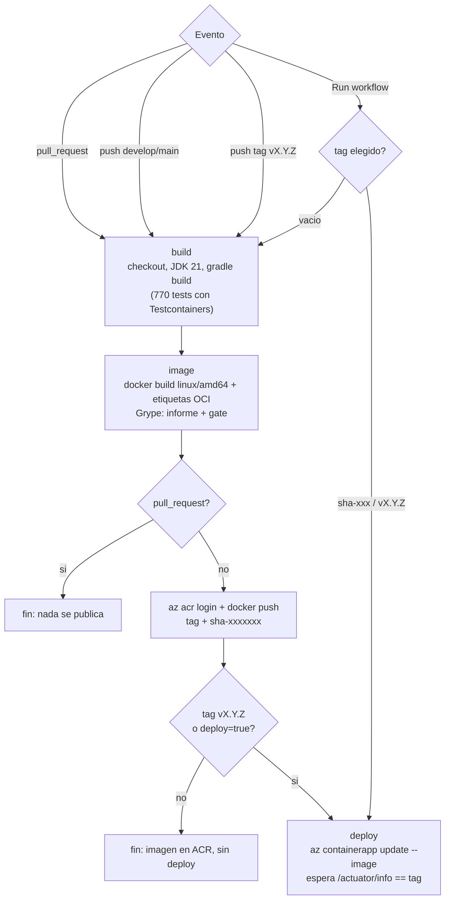

# CI/CD

Pipeline: `.github/workflows/backend-ci.yml`. Verificacion de credenciales:
`.github/workflows/azure-check.yml`.

- **Integracion continua (CI)**: cada cambio que llega a GitHub se compila,
  se testea, se empaqueta en una imagen y se escanea, automaticamente. Si
  algo falla, el cambio no avanza.
- **Despliegue continuo (CD)**: una imagen que paso la CI se publica y se
  pone en produccion sin pasos manuales. Aca el CD es **condicionado**: no
  todo push despliega.

## Flujo



| Job | Que hace | Corre en |
|---|---|---|
| `build` | `./gradlew build` (compila, tests, Testcontainers) + tests de `scripts/azure.py` | Todo, salvo redeploy de un tag existente |
| `image` | Build de la imagen, Grype, push al ACR | Todo; el push no corre en pull requests |
| `deploy` | Actualiza la Container App y espera a que sirva la version nueva | Tag `vX.Y.Z` o ejecucion manual con `deploy=true` |

Los tests no se repiten dentro del `docker build`: los corre el job `build`
antes, y la imagen solo se construye si pasaron.

## Casos de la defensa

| Caso | Como se dispara | Build y tests | Imagen en ACR | Deploy |
|---|---|---|---|---|
| **A**: cambio sin deploy | `git push` a `develop` | Si | `sha-<7>` | **No** |
| **B**: cambio con deploy | `git tag v1.0.0` + `git push origin v1.0.0` | Si | `v1.0.0` y `sha-<7>` | **Si** |
| **C**: manual | Actions > backend-ci > Run workflow, `deploy` tildado | Si (o no, si se elige un tag existente) | Si | **Si** (o no, sin tildar) |
| PR | Pull request a `develop`/`main` | Si | No (solo se construye y escanea) | No |

La condicion esta en el `if:` del job `deploy`:

```yaml
if: >-
  ${{ always() && !cancelled() && !contains(needs.*.result, 'failure') &&
      (startsWith(github.ref, 'refs/tags/v') ||
       (github.event_name == 'workflow_dispatch' && inputs.deploy)) }}
```

Es explicita: depende del tipo de evento y de un input, no del texto del
commit (el workflow de la catedra deducia el deploy de palabras como
`chore:` o `/deploy` en el mensaje).

Para cambiar las condiciones (por ejemplo, desplegar tambien cada push a
`main`), se agrega una linea al `if:`:

```yaml
       github.ref == 'refs/heads/main' ||
```

## Versionado

| Evento | Tags que se publican |
|---|---|
| push de rama / Run workflow | `sha-<7 primeros caracteres del commit>` |
| push de tag `vX.Y.Z` | `vX.Y.Z` y `sha-<7>` (misma imagen, mismo digest) |

Nunca `latest`: siempre se sabe que commit genero la imagen.

- **Que version se construyo**: resumen del run (tabla "Imagen publicada") o
  `python scripts/azure.py tags`.
- **Que commit la origino**: el `sha-<7>` del tag, la etiqueta OCI
  `org.opencontainers.image.revision` y `/actuator/info` (`revision`).
- **Donde quedo**: `acringenieriaum.azurecr.io/securepassb:<tag>`.
- **Que version esta desplegada**: `GET /actuator/info` o
  `python scripts/azure.py status`.
- **Desplegar una version anterior**: Run workflow con `tag=<tag viejo>` y
  `deploy` tildado, o `python scripts/azure.py deploy --tag <tag viejo>`.

`scripts/azure.py` usa la misma regla (`image_tag()`), asi una imagen subida
a mano y una del CI nunca chocan de nombre.

## Grype en el pipeline

1. Informe completo (tabla en el log, SARIF y JSON como artifact
   `grype-<tag>`, resumen por severidad en el resumen del run).
2. **Gate**: `grype --only-fixed --fail-on critical`. El pipeline falla si
   aparece una vulnerabilidad **critica con correccion disponible**. Las
   criticas sin fix (ver `docs/vulnerabilidades.md`) no bloquean: no hay nada
   que actualizar.

Para endurecer el gate: `--fail-on high`. Para apagarlo temporalmente:
comentar el paso "grype (gate)" (nunca borrar el informe).

## Secretos y variables que usa

| Nombre | Tipo | Uso |
|---|---|---|
| `AZURE_CREDENTIALS` | Secret | `azure/login` con el Service Principal |
| `ACR_NAME`, `IMAGE_NAME`, `AZURE_RESOURCE_GROUP`, `CONTAINER_APP_NAME` | Variables | Nombres de recursos |

El pipeline no ve ningun secreto de la aplicacion (base, JWT): esos viven en
la Container App.

## Guia de GitHub

**1-2. A que repositorio esta conectado / remoto Git**

```powershell
git remote -v        # origin  https://github.com/Menguitahh/acr-securepassb.git
git status -sb       # rama actual y si esta adelantada/atrasada
```

**3-5. Rama, commit, push**

```powershell
git checkout develop
git pull
git checkout -b feature/admin-mi-cambio
# editar archivos
git add <archivos>
git commit -m "feat(admin): describir el cambio"
git push -u origin feature/admin-mi-cambio
gh pr create --base develop        # o desde la web: boton "Compare & pull request"
```

**6. Donde estan los workflows**: carpeta `.github/workflows/` del repo.

**7-8. Pestana Actions / habilitarla**: repo en GitHub > pestana **Actions**.
Si estuviera deshabilitada: **Settings** > **Actions** > **General** >
*Actions permissions* > **Allow all actions and reusable workflows** > Save.

**9. Secrets**: **Settings** > **Secrets and variables** > **Actions** >
pestana **Secrets** > **New repository secret**.

**10. Variables**: misma pantalla, pestana **Variables** > **New repository
variable**. Por terminal: `gh variable list`, `gh secret list` (muestra
nombres, nunca valores).

**11. Ejecutar a mano**: **Actions** > **backend-ci** (columna izquierda) >
**Run workflow** > rama `develop` > tildar `deploy` y/o escribir `tag` >
**Run workflow**. Terminal:

```powershell
gh workflow run backend-ci --ref develop -f deploy=true
gh workflow run backend-ci --ref develop -f deploy=true -f tag=sha-1a2b3c4   # rollback
```

**12-13. Leer logs e identificar errores**: Actions > click en el run > click
en el job (`build`, `image`, `deploy`) > expandir el paso con la cruz roja.
El primer error real suele estar arriba del `Error: Process completed with
exit code 1`. Terminal: `gh run list -w backend-ci`, `gh run view <id>
--log-failed`.

**14-16. Que imagen, que SHA, si hubo deploy**: en el run, la pagina
**Summary** muestra las tablas *Grype*, *Imagen publicada* (tag, commit,
digest) y, si desplego, *Deploy* (URL, version, revision, readiness). Si el
job `deploy` aparece gris con "skipped", no hubo deploy.

**17. Reintentar un run fallido**: en el run, **Re-run jobs** > **Re-run
failed jobs**. Terminal: `gh run rerun <id> --failed`.

## Que hacer si falla

| Falla en | Causa tipica | Que hacer |
|---|---|---|
| `build` | Test roto o no compila | Ver el test en el log, reproducir con `.\gradlew.bat test`, corregir |
| `image` / docker build | Dockerfile o dependencia | `docker build .` local |
| `image` / grype (gate) | Nueva critica con fix publicado | Actualizar la dependencia o la imagen base (ver `docs/vulnerabilidades.md`) |
| `image` / azure login | `AZURE_CREDENTIALS` vencido o mal cargado (`AADSTS7000222`) | Renovar el secreto del SP y volver a cargarlo |
| `deploy` / verificar imagen | Se pidio un tag que no existe | `python scripts/azure.py tags` y usar uno de la lista |
| `deploy` / esperar version | La app no arranca con la imagen nueva | `python scripts/azure.py logs`; volver a la version anterior con `deploy --tag` |
