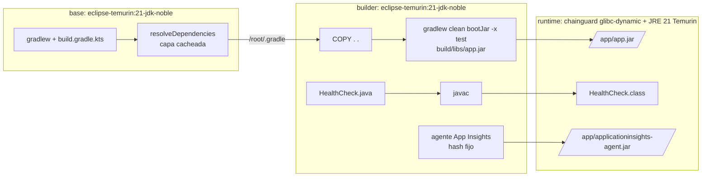
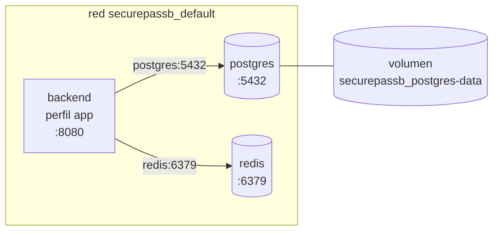

# Docker

## Imagen del backend (`Dockerfile`)

Basado en la plantilla de la catedra (Maven, `base -> builder -> runtime`
distroless), adaptada a Gradle.



### Plantilla de la catedra vs este Dockerfile

| Plantilla (Maven) | Aca (Gradle) | Por que |
|---|---|---|
| `FROM maven:3.9-eclipse-temurin-21-noble` | `FROM eclipse-temurin:21-jdk-noble` | Mismo JDK 21 sobre Ubuntu noble; Gradle llega por el wrapper (`gradlew`), no hace falta una imagen con Gradle instalado |
| `apt-get install build-essential` | (no esta) | gcc/make no los usa Java (venia del Dockerfile de Go). No llegan a la imagen final, pero suman minutos a cada build |
| `COPY pom.xml .` + `mvn dependency:resolve` | `COPY gradlew settings.gradle.kts build.gradle.kts gradle` + `gradlew resolveDependencies` | `resolveDependencies` (en `build.gradle.kts`) descarga los jars sin compilar; `gradlew dependencies` solo resuelve el arbol y no bajaria nada |
| `COPY --from=base /root/.m2 /root/.m2` | `COPY --from=base /root/.gradle /root/.gradle` | Cache de dependencias de la etapa base |
| `mvn clean package -DskipTests` | `gradlew clean bootJar -x test` | Los tests los corre el CI antes |
| `target/app.jar` | `build/libs/app.jar` | `tasks.bootJar { archiveFileName.set("app.jar") }` |
| `distroless/java21-debian13:nonroot` | `cgr.dev/chainguard/glibc-dynamic` (digest fijo) + `/opt/java/openjdk` copiado de `eclipse-temurin:21-jre-noble` | Misma idea (sin shell ni gestor de paquetes) pero sin los paquetes Debian: Grype 68 -> 0 en la base. Ver `docs/vulnerabilidades.md` |
| `USER nobody`, `WORKDIR /app`, `EXPOSE 8080` | igual | |
| `ENV SPRING_OUTPUT_ANSI_ENABLED=ALWAYS` | igual | Sin efecto en prod: los logs son JSON |
| `ENV JAVA_OPTS=""` + `"${JAVA_OPTS}", "{0}", "{@}"` en el `ENTRYPOINT` | `ENV JAVA_TOOL_OPTIONS=...` y `ENTRYPOINT [ "java", "-Djava.security.egd=...", "-jar", "/app/app.jar" ]` | En formato JSON (exec form) Docker no expande variables y distroless no tiene shell: java recibia los textos literales `${JAVA_OPTS}`, `{0}`, `{@}` como argumentos de la app y `JAVA_OPTS` nunca se aplicaba. `JAVA_TOOL_OPTIONS` la lee la JVM sola |
| - | `ARG VERSION/REVISION/CREATED/SOURCE` + `LABEL org.opencontainers.image.*` + `ENV APP_VERSION/APP_REVISION` | Trazabilidad: el CI pasa tag y SHA; `/actuator/info` los muestra y el job deploy los verifica |
| - | `ENV SPRING_PROFILES_ACTIVE=prod` | Base, Redis y secretos obligatorios; logs JSON |
| - | Agente de Application Insights (`ADD --checksum`, `COPY --chmod=444`) | Monitoreo en Azure; inactivo salvo `JDK_JAVA_OPTIONS` |
| - | `HEALTHCHECK` con una clase Java | Distroless no tiene curl |

Lo que se resigno respecto del Dockerfile anterior: el jar ya no se extrae en
capas, asi que un cambio de codigo vuelve a subir la capa de la app entera
(96 MB) en vez de 3 MB.

Archivos relacionados: `.dockerignore` (allowlist: solo entra lo que el
Dockerfile copia, nunca `.env`), `.gitattributes` (`gradlew` con LF: con CRLF
falla en Linux).

### Etiquetas OCI y version

| Build arg | Etiqueta | Ejemplo |
|---|---|---|
| `VERSION` | `org.opencontainers.image.version` | `sha-c84f086` o `v1.0.0` |
| `REVISION` | `org.opencontainers.image.revision` | SHA completo del commit |
| `CREATED` | `org.opencontainers.image.created` | `2026-10-11T22:27:04Z` |
| `SOURCE` | `org.opencontainers.image.source` | URL del repo |

`VERSION` y `REVISION` tambien quedan como `APP_VERSION` / `APP_REVISION` y
se ven en `GET /actuator/info` (publico):

```json
{"app":{"version":"sha-c84f086","revision":"c84f086faabe6503f9bfd0972266303a16774ee0"}}
```

### Construir

```powershell
$sha = git rev-parse --short=7 HEAD
docker build --platform linux/amd64 `
  --build-arg VERSION=sha-$sha `
  --build-arg REVISION=$(git rev-parse HEAD) `
  --build-arg CREATED=$((Get-Date).ToUniversalTime().ToString("yyyy-MM-ddTHH:mm:ssZ")) `
  -t securepassb:sha-$sha .
```

`--platform linux/amd64`: Azure Container Apps corre amd64. En Windows/Linux
x86 es la arquitectura nativa; en una Mac con Apple Silicon (arm64) este flag
es obligatorio o la imagen no arranca en Azure.

### Inspeccionar

```powershell
docker image inspect securepassb:sha-$sha --format '{{json .Config.Labels}}'   # etiquetas OCI
docker image inspect securepassb:sha-$sha --format '{{json .Config.Env}}'      # sin secretos
docker history securepassb:sha-$sha                                              # capas y tamanos
```

### Verificacion del Dockerfile basado en la plantilla (2026-10-12)

| Prueba | Resultado |
|---|---|
| Build | OK, 105 s en frio |
| Compose | `healthy`; `/actuator/info` con version y commit; readiness UP |
| Login / endpoint protegido sin y con token | 200 / 401 y 200 |
| Usuario del proceso | `nobody`; `docker exec ... sh`: no hay shell |
| Agente de Application Insights activado | `Agent 3.7.10 started successfully`; Spring en 8,9 s |
| Grype | 70 (2 criticas sin fix), igual que antes; gate `--only-fixed --fail-on critical` aprobado |
| Con la base glibc-dynamic (despues) | Grype 2, Trivy 2 (Spring); export XLSX OK; agente y TLS OK |

### Verificacion anterior (2026-10-11, imagen `sha-c84f086`)

| Prueba | Resultado |
|---|---|
| Build | OK, 1 min 36 s en frio |
| Arranque | `Started SecurepassApplication in 6.947 seconds`, perfil prod |
| Healthcheck de Docker | `healthy` |
| `/actuator/health` / `/actuator/info` | UP / version y SHA correctos |
| Login KO / OK | 401 / 200 |
| Endpoint protegido sin / con token | 401 / 200 |
| Usuario del proceso | UID 65532 |
| `docker exec ... sh` | `executable file not found`: no hay shell |
| Variables en la imagen | Solo version, perfil y opciones de JVM; ningun secreto |
| Filesystem de la imagen | Sin `.env`, claves, `.git`, tests ni codigo fuente; 0 apariciones de los placeholders de `.env.example` |
| `docker history` | 0 comandos con `secret`, `password` o `jwt` |

## Docker Compose (`docker-compose.yml`)

Dockerfile describe **una imagen**; Compose describe **un entorno**: que
contenedores corren juntos, con que variables, red, volumenes y orden de
arranque. En Azure no se usa Compose: cada pieza es un recurso propio.



| Servicio | Imagen | Persistencia | Healthcheck |
|---|---|---|---|
| `postgres` | `postgres:16-alpine` | Volumen `securepassb_postgres-data` | `pg_isready` |
| `redis` | `redis:7-alpine` | Ninguna, a proposito (sesiones y rate limit son efimeros) | `redis-cli ping` |
| `backend` | `securepassb:local` (build del Dockerfile) | Ninguna | `HEALTHCHECK` de la imagen (readiness) |

- **Perfil `app`:** el backend solo arranca con `--profile app`. Sin el
  perfil, `docker compose up -d` levanta solo Postgres y Redis, como antes,
  para correr el backend con `gradlew bootRun`.
- **Orden:** `depends_on: condition: service_healthy`: el backend espera a
  que Postgres y Redis esten sanos.
- **Red:** la red por defecto del proyecto. Dentro de ella los servicios se
  llaman por su nombre (`postgres`, `redis`), no por `localhost`.
- **Variables:** Compose lee `.env` (copia de `.env.example`, ignorado por
  git). El archivo versionado no tiene secretos: los defaults son los
  placeholders de desarrollo.
- **`name: securepassb`:** nombre de proyecto fijo, asi los contenedores y el
  volumen se llaman igual sin importar el nombre de la carpeta.

### Comandos (PowerShell, desde la raiz del repo)

| Que | Comando |
|---|---|
| Preparar variables (una vez) | `Copy-Item .env.example .env` |
| Levantar todo | `docker compose --profile app up -d --build` |
| Solo base y Redis (para `bootRun`) | `docker compose up -d` |
| Ver estado | `docker compose --profile app ps` |
| Logs en vivo del backend | `docker compose --profile app logs -f backend` |
| Ultimas 100 lineas | `docker compose --profile app logs --tail 100 backend` |
| Reconstruir tras un cambio de codigo | `docker compose --profile app up -d --build backend` |
| Reiniciar el backend | `docker compose --profile app restart backend` |
| Detener sin borrar nada | `docker compose --profile app stop` |
| Borrar contenedores y red, **conservando datos** | `docker compose --profile app down` |
| Borrar tambien la base (**reset total**) | `docker compose --profile app down -v` |

Comprobar que funciona:

```powershell
docker compose --profile app ps                     # los tres "(healthy)"
curl.exe http://localhost:8080/actuator/health      # {"status":"UP",...}
curl.exe http://localhost:8080/actuator/info        # version de la imagen
```

Para sembrar la demo en el contenedor: en `.env` poner
`SPRING_PROFILES_ACTIVE=dev`, `SECUREPASS_DEV_SEED=true` y
`SECUREPASS_DEMO_SEED=true`, y volver a correr
`docker compose --profile app up -d` (no hace falta `--build`).

### Verificacion (2026-10-11)

| Prueba | Resultado |
|---|---|
| `docker compose up -d` sin `.env` (modo infra) | OK, solo postgres y redis |
| `--profile app up -d --build` | Backend espera a postgres/redis healthy; los tres `healthy` |
| Endpoints | health UP, info con version, login 200, invitaciones 401 sin token / 200 con token |
| `docker compose logs backend` | Logs JSON (perfil prod) |
| `down` sin `-v` y `up` | 0 contenedores tras el down; volumen intacto; `access_logs` 238 antes y despues |
| Backend sin `SECUREPASS_JWT_SECRET` | Reinicia en bucle; log: `securepass.jwt.secret debe tener al menos 32 bytes` |
