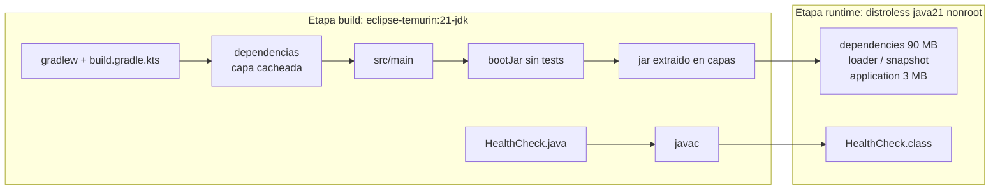

# Docker

## Imagen del backend (`Dockerfile`)



| Decision | Por que |
|---|---|
| Multietapa | El JDK, Gradle y el codigo fuente quedan en la etapa `build`; la imagen final solo lleva el JRE y el jar extraido |
| `eclipse-temurin:21-jdk-jammy` para compilar | Java 21 (el toolchain del proyecto). Gradle lo detecta y no descarga otro JDK |
| `gcr.io/distroless/java21-debian12:nonroot` para correr | Sin shell, sin gestor de paquetes, sin curl: menos superficie de ataque y menos CVEs. 261 MB contra 407 MB de `eclipse-temurin:21-jre-jammy` |
| Usuario `65532` (nonroot) | El proceso no corre como root (verificado con `docker top`) |
| Dependencias antes que el codigo | `./gradlew dependencies` en su propia capa: mientras no cambie `build.gradle.kts`, Docker la reutiliza |
| `--mount=type=cache` | La cache de Gradle sobrevive entre builds |
| Jar extraido en capas (`jarmode=tools`) | Un cambio de codigo solo reconstruye la capa `application` (3 MB), no los 90 MB de dependencias |
| Tests fuera del build | Los corre el CI antes. Testcontainers necesita Docker y no hay Docker dentro de `docker build` |
| `HEALTHCHECK` con una clase Java | Distroless no tiene curl. `docker/HealthCheck.java` pide `/actuator/health/readiness` |
| `SPRING_PROFILES_ACTIVE=prod` por defecto | Base, Redis y secretos obligatorios por variable de entorno; logs JSON |
| `MaxRAMPercentage=75` | El heap se ajusta a la memoria del contenedor (Azure le da 1 GiB) |
| `ExitOnOutOfMemoryError` | Ante un OOM el proceso muere y el orquestador lo reinicia, en vez de quedar zombie |

Archivos relacionados: `.dockerignore` (allowlist: solo entra lo que el
Dockerfile copia, nunca `.env`), `.gitattributes` (`gradlew` con LF: con CRLF
falla en Linux).

### Etiquetas OCI y version

| Build arg | Etiqueta | Ejemplo |
|---|---|---|
| `VERSION` | `org.opencontainers.image.version` | `sha-c84f086` o `v1.0.0` |
| `REVISION` | `org.opencontainers.image.revision` | SHA completo del commit |
| `CREATED` | `org.opencontainers.image.created` | `2026-10-11T22:27:04Z` |
| `SOURCE` | `org.opencontainers.image.source` | URL del repo |

`VERSION` y `REVISION` tambien quedan como `APP_VERSION` / `APP_REVISION` y
se ven en `GET /actuator/info` (publico):

```json
{"app":{"version":"sha-c84f086","revision":"c84f086faabe6503f9bfd0972266303a16774ee0"}}
```

### Construir

```powershell
$sha = git rev-parse --short=7 HEAD
docker build --platform linux/amd64 `
  --build-arg VERSION=sha-$sha `
  --build-arg REVISION=$(git rev-parse HEAD) `
  --build-arg CREATED=$((Get-Date).ToUniversalTime().ToString("yyyy-MM-ddTHH:mm:ssZ")) `
  -t securepassb:sha-$sha .
```

`--platform linux/amd64`: Azure Container Apps corre amd64. En Windows/Linux
x86 es la arquitectura nativa; en una Mac con Apple Silicon (arm64) este flag
es obligatorio o la imagen no arranca en Azure.

### Inspeccionar

```powershell
docker image inspect securepassb:sha-$sha --format '{{json .Config.Labels}}'   # etiquetas OCI
docker image inspect securepassb:sha-$sha --format '{{json .Config.Env}}'      # sin secretos
docker history securepassb:sha-$sha                                              # capas y tamanos
```

### Verificacion (2026-10-11, imagen `sha-c84f086`)

| Prueba | Resultado |
|---|---|
| Build | OK, 1 min 36 s en frio |
| Arranque | `Started SecurepassApplication in 6.947 seconds`, perfil prod |
| Healthcheck de Docker | `healthy` |
| `/actuator/health` / `/actuator/info` | UP / version y SHA correctos |
| Login KO / OK | 401 / 200 |
| Endpoint protegido sin / con token | 401 / 200 |
| Usuario del proceso | UID 65532 |
| `docker exec ... sh` | `executable file not found`: no hay shell |
| Variables en la imagen | Solo version, perfil y opciones de JVM; ningun secreto |
| Filesystem de la imagen | Sin `.env`, claves, `.git`, tests ni codigo fuente; 0 apariciones de los placeholders de `.env.example` |
| `docker history` | 0 comandos con `secret`, `password` o `jwt` |
