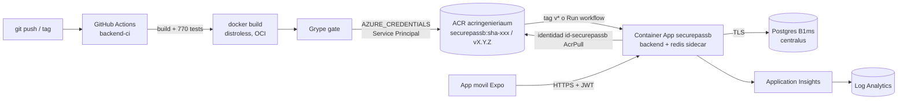

# Guia para el parcial

Ingenieria de Software Aplicada (UM): lo de la cursada (Docker, ACR, Container
Apps, Service Principal, GitHub Actions, Grype, monitoreo) aplicado a
Securepass (Spring Boot + React Native). Todo lo de aca fue ejecutado y
verificado; los numeros salen de corridas reales del 2026-10-11/12.

**URL del backend:** https://securepassb.proudbush-b955ebd5.eastus.azurecontainerapps.io
**Repo:** https://github.com/Menguitahh/acr-securepassb (publico)
**Version en produccion:** `v1.1.0` (`/actuator/info`)

## Mapa del trabajo



## Archivos creados y modificados

| Archivo | Que es | Fase |
|---|---|---|
| `Dockerfile` | Imagen multietapa: compila con JDK 21, corre en distroless Java 21 nonroot, etiquetas OCI, agente de Application Insights | 4, 6, 13 |
| `.dockerignore` | Allowlist del contexto de build (nunca entra `.env`) | 4 |
| `.gitattributes` | `gradlew` con LF (con CRLF el build en Linux falla) | 4 |
| `docker/HealthCheck.java` | HEALTHCHECK sin curl (distroless no tiene shell) | 4 |
| `docker-compose.yml` | Postgres + Redis, y el backend con `--profile app` | 5 |
| `src/main/resources/application.yml` | Hikari, readiness con db+redis, `/actuator/info` con version, OpenAPI 3.0 | 3, 4, 6 |
| `src/main/resources/application-prod.yml` | Perfil prod sin defaults de base ni Redis | 3 |
| `SecurityConfig.java` | Metricas de Actuator solo para `PLATFORM_ADMIN`; 403 correcto | 2 |
| `build.gradle.kts` | Spring Boot 3.5.16 + parches de seguridad | 6 |
| `.github/workflows/backend-ci.yml` | CI/CD: build, imagen, Grype, push, deploy condicionado | 10, 11 |
| `.github/workflows/codeql.yml` | Analisis estatico | 14 |
| `.github/workflows/azure-check.yml` | Prueba que GitHub entra a Azure | 8 |
| `scripts/azure.py` (+ `test_azure.py`) | Operacion manual: build, push, deploy, rollback, start/stop, logs, monitor | 9, 12, 13 |
| `docs/postman/securepassb-jwt.postman_collection.json` | Demostracion de JWT | 2 |
| `docs/azure/setup-db.sql` | Usuario de aplicacion y permisos en Postgres de Azure | 7 |
| Tests nuevos | `ActuatorExposureHttpTest`, `MainApplicationYmlTest` | 2, 6 |
| `docs/*.md` | `arquitectura`, `docker`, `azure`, `ci-cd`, `seguridad`, `vulnerabilidades`, `monitoreo`, esta guia | todas |

Fuera del repo: Postgres `psql-securepassb-um`, Container App `securepassb`,
identidad `id-securepassb`, Application Insights `appi-securepassb`,
secretos de GitHub y de la Container App, `%USERPROFILE%\.securepassb\azure-secrets.env`.

## Fase 16: estado de los requisitos

| # | Requisito | Estado | Archivo o recurso | Prueba realizada | Resultado |
|---|---|---|---|---|---|
| 1 | Spring Boot funcional | COMPLETADO | backend | `gradlew build`; app en Azure | 770/770 tests; readiness UP |
| 2 | React Native funcional | COMPLETADO | `acr-securepassf/mobile` | Emulador Pixel_8 contra Azure | Login, turno, QR |
| 3 | Autenticacion JWT | COMPLETADO | `JwtTokenProvider`, `AuthController` | Postman contra Azure | 21/21 aserciones |
| 4 | Seguridad de endpoints | COMPLETADO | `SecurityConfig` | 401 / 403 / 200 | OK |
| 5 | UserDetailsService | NO CORRESPONDE | `LoginUseCase` + `CurrentUser` | - | Login propio + JWT stateless; equivalencia en `docs/seguridad.md` |
| 6 | PasswordEncoder | COMPLETADO | BCrypt costo 12 | Login 401/200 | OK |
| 7 | Configuracion de base | COMPLETADO | `application(-prod).yml` | Arranque prod sin variables | Falla con mensaje claro |
| 8 | HikariCP | COMPLETADO | `spring.datasource.hikari` | Metricas en Azure | max 10, timeout 0 |
| 9 | Variables de entorno | COMPLETADO | `.env.example`, Container App | Faltantes probadas | Ver `docs/arquitectura.md` |
| 10 | Dockerfile | COMPLETADO | `Dockerfile` | build + run | healthy |
| 11 | Docker Compose | COMPLETADO | `docker-compose.yml` | `--profile app up` | 3 servicios healthy, datos persisten |
| 12 | Docker build | COMPLETADO | CI + `azure.py build` | Runs | OK |
| 13 | Imagen optimizada | COMPLETADO | distroless + capas | Tamano | 261 MB de base vs 407 MB; cambio de codigo = 3 MB |
| 14 | Versionado de imagenes | COMPLETADO | `sha-<7>`, `vX.Y.Z` | ACR | Sin `latest`; `sha-` inmutable |
| 15 | Etiquetas OCI | COMPLETADO | `Dockerfile` | `docker inspect` | version, revision, created, source |
| 16 | Grype | COMPLETADO | CI + `docs/vulnerabilidades.md` | Escaneos | 194 -> 70 |
| 17 | CVE | COMPLETADO | `docs/vulnerabilidades.md` | Analisis | Cada CVE pendiente justificado |
| 18 | CVSS | COMPLETADO | idem | idem | Puntajes en el informe |
| 19 | Reduccion de vulnerabilidades | COMPLETADO | Base debian13, Boot 3.5.16, parches | Grype antes/despues | Criticas 10 -> 2 (sin fix, no aplicables); `--only-fixed` vacio |
| 20 | GitHub Actions | COMPLETADO | `.github/workflows/` | Runs | Verde |
| 21 | CI | COMPLETADO | job build + image | PR y push | OK |
| 22 | CD | COMPLETADO | job deploy | Tag v1.0.0, v1.1.0 | Desplego y verifico la version |
| 23 | CI sin despliegue | COMPLETADO | push a develop | Caso A | Imagen en ACR, Azure sin cambios |
| 24 | Despliegue condicionado | COMPLETADO | `if:` del job deploy | Casos A, B, C | OK |
| 25 | GitHub Secrets | COMPLETADO | `AZURE_CREDENTIALS` | `gh secret list` | Solo ese secreto |
| 26 | Service Principal | COMPLETADO | appId `542811c2...` | `azure-check`; asignar rol | Login OK; `AuthorizationFailed` al querer asignar roles |
| 27 | Azure Subscription | COMPLETADO | Azure for Students | `az account show` | Enabled |
| 28 | Resource Group | COMPLETADO | `universidad` | `az resource list` | Todos los recursos ahi |
| 29 | Azure Container Registry | COMPLETADO | `acringenieriaum` (Basic) | `azure.py tags` | Imagenes versionadas |
| 30 | Azure Container Apps | COMPLETADO | `securepassb` | `azure.py status` | Running, revisiones |
| 31 | Base de datos en Azure | COMPLETADO | `psql-securepassb-um` | Flyway + readiness | 24 migraciones, TLS obligatorio |
| 32 | Configuracion de secretos | COMPLETADO | Secretos de la Container App | `secretref` | 4 secretos, ninguno en el repo |
| 33 | Logs | COMPLETADO | stdout JSON -> Log Analytics | KQL | OK |
| 34 | Metricas | COMPLETADO | Micrometer -> Application Insights | `AppMetrics` | Hikari, JVM, HTTP |
| 35 | Health checks | COMPLETADO | liveness/readiness + probes | Postgres/Redis caidos | readiness 503, liveness 200 |
| 36 | Spring Boot Actuator | COMPLETADO | `/actuator/*` | Postman 12-13 | Solo health/info publicos |
| 37 | Monitoreo desde Azure | COMPLETADO | `appi-securepassb` | KQL | Requests, dependencias, login |
| 38 | Pruebas con Postman | COMPLETADO | coleccion | Local 23/23, Azure 21/21 | OK |
| 39 | Integracion React Native-Azure | COMPLETADO | `mobile/.env` | Emulador + App Insights | Cada accion vista en el servidor |
| 40 | Administracion de aplicaciones | COMPLETADO | `azure.py`, Portal | stop/start/rollback | OK |
| 41 | CodeQL | COMPLETADO | `codeql.yml` | Runs | 0 alertas; detecto y se corrigio 1 fuga potencial |
| 42 | Documentacion | COMPLETADO | `README.md`, `docs/` | - | - |

Pendientes conocidos (no bloquean la demo):
- Proveedor de email real: con `logging`, los links de activacion quedan en
  los logs de Azure (`docs/seguridad.md`).
- El secreto del Service Principal no se puede rotar ni ver su vencimiento:
  la cuenta de alumno no tiene acceso a Entra ID (`docs/azure.md`).
- Redis es por replica: escala maxima 1 (`docs/azure.md`).
- Spring Boot 4 cerraria las 2 criticas de Spring (no aplicables).

## Simulacro de defensa

### Parte 1: "Hace un cambio, subilo, construi una imagen versionada, publicala en ACR, pero no hagas deploy"

```powershell
cd C:\Users\lucia\Documents\GitHub\acr-securepassb
git checkout develop; git pull
git checkout -b feature/admin-cambio-parcial
# hacer el cambio (por ejemplo un texto en src/main/...)
git add -A; git commit -m "feat(admin): cambio para el parcial"
git push -u origin feature/admin-cambio-parcial
gh pr create --base develop --fill        # CI del PR: build + imagen + Grype, nada se publica
gh pr checks --watch
gh pr merge --squash --delete-branch      # push a develop = caso A
git checkout develop; git pull
gh run watch                              # build -> image -> deploy SKIPPED
python scripts/azure.py tags              # aparece sha-<commit nuevo>
curl.exe https://securepassb.proudbush-b955ebd5.eastus.azurecontainerapps.io/actuator/info   # sigue la version anterior
```

Que mostrar: en GitHub > Actions > el run > **Summary**: tabla de Grype y
"Imagen publicada" (tag, commit, digest), y el job **deploy en gris
(skipped)**. En el Portal: ACR > Repositories > securepassb > el tag nuevo.

### Parte 2: "Ahora desplega esa misma version, comproba que funciona, mostrame los logs y detene la aplicacion"

```powershell
$tag = python scripts/azure.py tag                          # sha-<commit actual de develop>
gh workflow run backend-ci --ref develop -f deploy=true -f tag=$tag   # redeploy sin rebuild
gh run watch                                                 # solo corre el job deploy
curl.exe https://securepassb.proudbush-b955ebd5.eastus.azurecontainerapps.io/actuator/info      # version = $tag
curl.exe https://securepassb.proudbush-b955ebd5.eastus.azurecontainerapps.io/actuator/health/readiness
python scripts/azure.py logs                                 # logs del backend
python scripts/azure.py stop
python scripts/azure.py status                               # "estado": "Stopped"; la URL da 404
python scripts/azure.py start                                # para volver (~40 s)
```

Alternativa por Portal: Actions > backend-ci > Run workflow (tildar deploy,
tag); Container App > Log stream; Overview > Stop.

Si piden desplegar con un tag de version: `git tag v1.2.0; git push origin
v1.2.0` (caso B, construye y despliega solo).

### Antes de la defensa

```powershell
az containerapp update -g universidad -n securepassb --min-replicas 1   # sin espera de arranque en frio
python scripts/azure.py status
```

Despues: `--min-replicas 0` para no consumir credito.

## Las 50 preguntas

Formato: **respuesta tecnica** / *para decirlo* / donde esta / como
mostrarlo.

**1. Que es integracion continua?**
Cada cambio que llega al repositorio se integra con el resto y se verifica
automaticamente: compilacion, tests, imagen y escaneo de seguridad.
*"Cada push se compila y se prueba solo; si algo se rompe lo sabemos en
minutos, no el dia de la entrega."* `backend-ci.yml`, jobs `build` e
`image`. Mostrar un run en Actions.

**2. Que es despliegue continuo?**
Una version que paso la CI se publica y se pone en produccion por el
pipeline, sin pasos manuales. Aca es condicionado: solo con un tag de
version o a pedido. *"El mismo pipeline la deja corriendo en Azure, pero
solo cuando lo decidimos."* Job `deploy`. Run del tag `v1.1.0`.

**3. Que sucede cuando hacemos un push a GitHub?**
GitHub dispara `backend-ci` (y `codeql`): compila, corre 770 tests con
Testcontainers, construye la imagen, la escanea con Grype y la sube al ACR
como `sha-<7>`. Si es un tag `v*`, ademas despliega. *"Push = pipeline."*
Actions > el run.

**4. Como generamos una imagen sin desplegar?**
Push a `develop` (caso A), o Run workflow sin tildar `deploy`. El job
`deploy` queda en `skipped`. Ver Simulacro parte 1.

**5. Como condicionamos el despliegue segun rama, version o commit?**
Con el `if:` del job `deploy`: `startsWith(github.ref, 'refs/tags/v')` o
`workflow_dispatch` con `deploy=true`. Para agregar una rama: `||
github.ref == 'refs/heads/main'`. No usamos el texto del commit: es fragil.
`docs/ci-cd.md`.

**6. Donde queda la imagen versionada?**
En `acringenieriaum.azurecr.io/securepassb:<tag>`. `python scripts/azure.py
tags`; Portal: ACR > Repositories > securepassb.

**7. Que es Azure Container Registry?**
Un registro privado de imagenes Docker administrado por Azure (como Docker
Hub, pero privado y dentro de la suscripcion). El CI hace push; Container
Apps hace pull. SKU Basic (bajado de Standard para ahorrar credito).

**8. De que grupo de recursos depende el ACR?**
`universidad` (East US). `az acr show -n acringenieriaum --query resourceGroup`.

**9. De que suscripcion depende el grupo?**
Azure for Students (`bf8523b9...`). `az account show`. Jerarquia:
Suscripcion > Resource Group > recursos. `docs/azure.md`.

**10. Para que usamos el Service Principal?**
Es la identidad con la que GitHub Actions (y la CLI) entran a Azure sin usar
una persona. Tiene `Contributor` solo sobre `universidad`. *"Es el usuario
del robot."*

**11. Donde usamos sus credenciales?**
En el secret `AZURE_CREDENTIALS` de GitHub (JSON con clientId, clientSecret,
tenantId, subscriptionId), en los pasos `azure/login` de `backend-ci.yml` y
`azure-check.yml`. En ningun otro lado.

**12. Como se autentica GitHub Actions contra Azure?**
`azure/login` presenta clientId + secret a Microsoft Entra ID y recibe un
token; los `az` siguientes lo usan, incluido `az acr login` para el push.
Alternativa sin secreto: OIDC (no disponible: sin acceso a Entra ID).
Mostrar: Actions > azure-check > Run workflow.

**13. Como publicamos una imagen versionada?**
Pipeline: job `image` paso "push al ACR". Manual:
`python scripts/azure.py build` + `push`. Ambos usan la misma regla de tag.

**14. Como comprobamos que existe en ACR?**
`python scripts/azure.py tags` o `az acr repository show-tags -n
acringenieriaum --repository securepassb -o table`. El deploy se niega a
usar un tag que no este.

**15. Como sabemos que version corre en Azure?**
`curl .../actuator/info` -> `{"app":{"version":"v1.1.0","revision":"<sha>"}}`.
Tambien `python scripts/azure.py status` (imagen) y el resumen del run.

**16. Como detenemos la app?**
`python scripts/azure.py stop` o Portal > Overview > Stop. Queda
`Stopped`, sin replicas; la URL da 404. Verificado.

**17. Como la iniciamos?**
`python scripts/azure.py start` o Overview > Start. Lista en ~40 s.

**18. Como la eliminamos?**
`python scripts/azure.py delete` (pide escribir el nombre) o Overview >
Delete. Irreversible para la app; no borra base, imagenes ni identidad. Se
recrea con `azure.py deploy`. No se ejecuto.

**19. Como consultamos los logs?**
`python scripts/azure.py logs -f`; Portal > Container App > Log stream; o
KQL sobre `ContainerAppConsoleLogs_CL`. `docs/monitoreo.md`.

**20. Como sabemos que funciona correctamente?**
Readiness `UP` (prueba Postgres y Redis), requests 2xx en Application
Insights, y una prueba funcional (login). *"Running no alcanza: la
readiness mira la base."*

**21. Como probamos el login con Postman?**
Importar `docs/postman/securepassb-jwt.postman_collection.json`, poner
`baseUrl` y credenciales de Azure, Run collection. Resultado 21/21.

**22. Cual es la URL real del backend?**
https://securepassb.proudbush-b955ebd5.eastus.azurecontainerapps.io

**23. Como funciona JWT?**
Tres partes base64url: header (`alg: HS256`), payload (`sub`, `nid`,
`roles`, `lots`, `iat`, `exp`) y firma HMAC-SHA256 con el secreto del
servidor. El cliente lo manda en `Authorization: Bearer`. Dura 15 min; el
refresh token (30 dias, en Redis) da uno nuevo. Postman 03.

**24. Como se validan los tokens?**
`JwtTokenProvider.validateToken`: recalcula la firma y compara en tiempo
constante, controla `exp`. Ignora el `alg` del header (siempre HS256): un
`alg=none` no pasa. Postman 06 (payload cambiado -> 401).

**25. Como protegemos los endpoints?**
`SecurityConfig`: todo autenticado salvo auth, activacion, health/info y
docs; `@PreAuthorize` por rol en cada controller. 401 sin token, 403 sin
rol. Postman 04, 08, 13.

**26. Para que sirve UserDetailsService?**
Es el puerto con el que Spring carga un usuario cuando el framework hace el
login. Aca el login es un caso de uso propio (`LoginUseCase` +
`UserRepository.findByIdentifier`) y cada request se autentica por JWT sin
ir a la base, asi que no hace falta. Equivalencia en `docs/seguridad.md`.

**27. Para que sirve HikariCP?**
Pool de conexiones JDBC: abrir una conexion TLS a Postgres es caro, el pool
las reutiliza. Configurado: max 10, min 2, timeout 10 s, keepalive 2 min.
Metricas en Azure: `hikaricp_connections_timeout = 0`.

**28. Donde guardamos variables y secretos?**
Pipeline: GitHub Secrets (`AZURE_CREDENTIALS`) y Variables (nombres).
Runtime: variables y secretos de la Container App (`secretref:`). Local:
`.env` (ignorado). Originales: `azure-secrets.env` fuera del repo.

**29. Donde configuramos la conexion a la base?**
`application.yml` / `application-prod.yml` leen `DB_URL`, `DB_USER`,
`DB_PASSWORD`. En Azure: variables `DB_URL` (con `sslmode=require`) y
`DB_USER`, y el secreto `db-password`.

**30. Como verificamos la conectividad con la base?**
`/actuator/health/readiness` (incluye `db`); `AppDependencies` en
Application Insights (cada consulta a Postgres con su duracion). Probado:
Postgres caido -> readiness 503.

**31. Que es un CVE?**
Identificador publico unico de una vulnerabilidad conocida, por ejemplo
CVE-2026-41293 (Tomcat).

**32. Que es CVSS?**
Puntaje de 0 a 10 de la gravedad tecnica (vector, complejidad, privilegios,
impacto): 9+ critica, 7-8.9 alta. No dice si nos afecta: eso es el analisis
de riesgo.

**33. Como usamos Grype?**
`docker run anchore/grype securepassb:local`; en el CI genera informe
(SARIF/JSON como artifact) y un gate `--only-fixed --fail-on critical`.

**34. Que vulnerabilidades encontramos?**
194 iniciales (10 criticas, 68 altas): Tomcat, Netty, Jackson, Spring
(Boot 3.3 sin soporte), libc/expat de Debian 12, JRE 21.0.10.

**35. Como las solucionamos?**
Base `distroless/java21-debian13`, Spring Boot 3.3.13 -> 3.5.16, parches de
Tomcat, Netty, Jackson, driver Postgres, commons-lang3, log4j. 194 -> 70; ya
no queda ninguna con fix disponible.

**36. Que hacemos si no tienen solucion?**
Se analiza si el codigo vulnerable se usa y se documenta: las 2 criticas de
Spring afectan `XsltView` y SSE, que no usamos; las 20 altas son de
librerias Debian que la JVM no ejerce. Mitigaciones: distroless sin shell,
usuario no-root. Se revisan en cada escaneo.

**37. Diferencias entre Grype y Trivy?**
Mismo resultado total (70) y mismas criticas. Grype usa CVSS de NVD (20
altas), Trivy el rating de Debian (9 altas) e informa el fix en la rama
siguiente. Trivy ademas detecta secretos, configuraciones y licencias.

**38. Que es CodeQL?**
Analisis estatico (SAST) de GitHub: convierte el codigo en una base de datos
y busca flujos peligrosos (por ejemplo de un parametro HTTP a un SQL sin
parametrizar). 0 alertas; en el PR #25 detecto un secreto que podia
terminar en un log y se corrigio antes del merge.

**39. Diferencia entre CodeQL y Grype?**
CodeQL mira nuestro codigo fuente; Grype mira las dependencias y paquetes
dentro de la imagen. Uno encuentra nuestros errores, el otro los de
terceros con CVE publicado.

**40. Como comprobamos que la app recibe peticiones?**
KQL `AppRequests | summarize count() by Name, ResultCode`; Live metrics en
Application Insights; Log stream.

**41. Como obtenemos metricas del login?**
`AppRequests | where Name == "POST /api/v1/auth/login" | summarize
count() by ResultCode` (exitosos y fallidos) y percentiles de `DurationMs`
(p50 ~476 ms por BCrypt).

**42. Como sabemos cuanto tarda una peticion?**
`DurationMs` de `AppRequests` (tiempo del servidor) y la metrica
`http.server.requests` de Micrometer con percentiles. Application Insights >
Performance.

**43. Relacion entre logs y los 12 factores?**
Factor XI: la app escribe eventos a stdout como stream y no gestiona
archivos; la plataforma los recolecta (Log Analytics). Es solo una parte de
la observabilidad: metricas, trazas y health checks son otras senales.

**44. Como configuramos desarrollo y produccion?**
Perfiles: default/`dev` (defaults de localhost, logs de texto, seeds) y
`prod` (`application-prod.yml`: base y Redis obligatorios, logs JSON). La
imagen trae `SPRING_PROFILES_ACTIVE=prod`; Compose y `bootRun` lo cambian.

**45. Como volvemos a una imagen anterior?**
Run workflow con `tag=<tag viejo>` y `deploy` (solo corre el job deploy), o
`python scripts/azure.py deploy --tag <tag>`, o Portal > Revisions >
Activate. Probado: rollback a `sha-99cb750` en ~2 min.

**46. Como funciona el Dockerfile multietapa?**
Etapa `build` (JDK 21 + Gradle): descarga dependencias en una capa
cacheada, compila y extrae el jar en capas. Etapa `runtime` (distroless):
copia solo el JRE y las capas. El resultado no tiene compilador, Gradle,
codigo fuente ni shell.

**47. Diferencia entre Dockerfile y Docker Compose?**
El Dockerfile describe como construir **una imagen**; Compose describe **un
entorno**: que contenedores corren juntos, red, volumenes, variables y orden
de arranque. En Azure no se usa Compose: cada pieza es un recurso.

**48. Como se conecta React Native con Spring Boot en Azure?**
`EXPO_PUBLIC_API_URL` en `mobile/.env` con la URL HTTPS; la app manda el JWT
en `Authorization` y lo guarda en SecureStore. Probado en el emulador: cada
accion aparece en Application Insights.

**49. Como comprobamos que usa credenciales reales y no hardcodeadas?**
`application-prod.yml` no tiene defaults (sin `DB_URL` la app no arranca);
la imagen no tiene secretos (inspeccion de env, filesystem e historial);
gitleaks sobre 213 commits sin secretos reales; los valores viven en los
secretos de la Container App.

**50. Que hariamos si el pipeline falla?**
Abrir el run, el job y el paso con la cruz roja. Build: reproducir con
`gradlew test`. Grype gate: actualizar la dependencia o la base. Login a
Azure: renovar `AZURE_CREDENTIALS`. Deploy: `azure.py logs` y rollback con
`deploy --tag`. Reintento: Re-run failed jobs. Tabla en `docs/ci-cd.md`.

## Anotaciones de Spring que pueden preguntar

`@Configuration`, `@Bean`, `@Component`, `@Service`, `@Entity`, `@Table`,
`@Column`, `@Transactional`, `@Override`, `@Autowired` (no se usa: inyeccion
por constructor): tabla con ejemplos reales en `docs/seguridad.md`.
