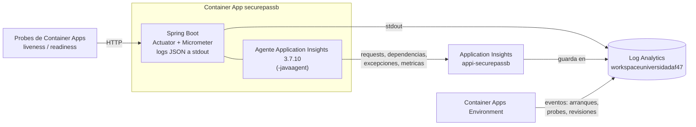

# Monitoreo y observabilidad

Como se sabe, desde Azure, que el backend funciona: no alcanza con que la
Container App diga `Running`.

## Piezas



| Senal | Fuente | Donde se ve |
|---|---|---|
| Salud | Actuator `/actuator/health/liveness` y `/readiness` (readiness incluye Postgres y Redis) | Probes de Container Apps; `curl` |
| Version corriendo | `/actuator/info` | `curl`, pipeline |
| Logs de la app | Logback JSON a stdout (perfil `prod`) | Log stream, tabla `ContainerAppConsoleLogs_CL` |
| Eventos de plataforma | Container Apps (arranques, probes fallidos, revisiones, escalado) | Tabla `ContainerAppSystemLogs_CL` |
| Requests (ruta, codigo, duracion) | Agente de Application Insights | `AppRequests`, Application Insights > Performance / Failures |
| Dependencias (cada consulta a Postgres y Redis) | Agente | `AppDependencies`, Application map |
| Excepciones | Agente | `AppExceptions`, Failures |
| Metricas (Hikari, JVM, HTTP) | Micrometer (Actuator); el agente las envia solo | `AppMetrics`; `/actuator/metrics` y `/actuator/prometheus` (solo `PLATFORM_ADMIN`) |

El agente no requiere cambios de codigo: esta en la imagen
(`/app/applicationinsights-agent.jar`, version y hash fijos en el
`Dockerfile`) y se activa con variables de la Container App:

| Variable | Valor |
|---|---|
| `JDK_JAVA_OPTIONS` | `-javaagent:/app/applicationinsights-agent.jar` |
| `APPLICATIONINSIGHTS_CONNECTION_STRING` | `secretref:appinsights-connection` |
| `APPLICATIONINSIGHTS_ROLE_NAME` | `securepassb` |

Sin esas variables (Docker Compose local) el agente no se carga.

## Configuracion (una vez)

1. Registrar el proveedor `Microsoft.Insights` (duenio de la suscripcion):
   Portal > Subscriptions > Azure for Students > Resource providers >
   `Microsoft.Insights` > Register.
2. Crear Application Insights **basado en el workspace existente** (no crea
   otro Log Analytics; los datos cuentan para el tope de 0,15 GB/dia):
   - Portal: **Application Insights** > **Create** > grupo `universidad`,
     nombre `appi-securepassb`, region East US, Resource Mode
     **Workspace-based**, workspace `workspaceuniversidadaf47` > Create.
   - CLI (lo que se ejecuto):
     ```bash
     WS=$(az monitor log-analytics workspace show -g universidad -n workspaceuniversidadaf47 --query id -o tsv)
     az rest --method put \
       --url "https://management.azure.com/subscriptions/<SUBSCRIPTION_ID>/resourceGroups/universidad/providers/Microsoft.Insights/components/appi-securepassb?api-version=2020-02-02" \
       --body "{\"location\":\"eastus\",\"kind\":\"web\",\"properties\":{\"Application_Type\":\"web\",\"WorkspaceResourceId\":\"$WS\",\"IngestionMode\":\"LogAnalytics\"}}"
     ```
3. El **connection string** (Portal: appi-securepassb > Overview >
   Connection String) va a `%USERPROFILE%\.securepassb\azure-secrets.env`
   como `APPINSIGHTS_CONNECTION_STRING`. Identifica el recurso donde se
   envia telemetria: no se commitea.
4. Activarlo en la app (crea una revision nueva):
   `python scripts/azure.py monitor`

Costo: la ingesta va al workspace (5 GB/mes gratis, tope de 0,15 GB/dia).

## Preguntas de la defensa

Las consultas se corren en el Portal: **Log Analytics workspaces** >
`workspaceuniversidadaf47` > **Logs** (o Application Insights > Logs), modo
KQL, pegar y **Run**.

**Como sabemos si Spring Boot esta funcionando?** Readiness (que ademas
prueba Postgres y Redis) y requests atendidas:

```bash
curl https://securepassb.proudbush-b955ebd5.eastus.azurecontainerapps.io/actuator/health/readiness
```

**Como sabemos si se conecta a la base?** Readiness `UP`, y cada consulta
queda registrada como dependencia:

```kusto
AppDependencies
| where TimeGenerated > ago(1h) and AppRoleName == "securepassb"
| summarize n=count(), p95=percentile(DurationMs, 95), ok=countif(Success) by DependencyType, Target
```

Resultado: `postgresql | psql-securepassb-um.postgres.database.azure.com | 13 | 25,6 ms | 13 ok`
y `redis | localhost | 12 | 1,4 ms | 12 ok`.

**Como sabemos si una peticion llego al servidor?**

```kusto
AppRequests
| where TimeGenerated > ago(1h) and AppRoleName == "securepassb"
| summarize n=count() by Name, ResultCode
| order by n desc
```

Resultado: `GET /api/v1/admin/lots 200 x10`, `401 x2`, `POST /api/v1/auth/login 200 x1 / 401 x2`, `GET /** 404 x1`, ...

**Como sabemos si el login funciono?**

```kusto
AppRequests
| where TimeGenerated > ago(1h) and Name == "POST /api/v1/auth/login"
| summarize intentos=count() by ResultCode, Success
```

Resultado: `401 False 2`, `200 True 1` (dos intentos con password incorrecta, uno correcto).

**Como medimos cuanto tardo una peticion?** Tiempo del lado del servidor
(sin la red del cliente):

```kusto
AppRequests
| where TimeGenerated > ago(1h) and AppRoleName == "securepassb"
| summarize n=count(), p50=percentile(DurationMs, 50), p95=percentile(DurationMs, 95), max=max(DurationMs) by Name
```

Resultado: login p50 476 ms (BCrypt con costo 12 en 0,75 vCPU, es a
proposito: frena fuerza bruta); `GET /api/v1/admin/lots` p50 33 ms;
health 56 ms. Portal: Application Insights > **Performance**.

**Como vemos un error?**

```kusto
union
  (AppExceptions | where TimeGenerated > ago(1h) | project TimeGenerated, tipo="excepcion", detalle=ProblemId),
  (AppRequests | where TimeGenerated > ago(1h) and toint(ResultCode) >= 500 | project TimeGenerated, tipo="5xx", detalle=Name)
```

En la prueba: sin filas (no hubo errores del servidor). Logs del backend
por nivel:

```kusto
ContainerAppConsoleLogs_CL
| where ContainerAppName_s == "securepassb" and ContainerName_s == "backend"
| extend nivel = extract('"level":"([A-Z]+)"', 1, Log_s)
| summarize n=count() by nivel
```

Portal: Application Insights > **Failures** (agrupa por excepcion y
endpoint, con el stack trace).

**Como revisamos los logs desde Azure?** Container App > **Monitoring** >
**Log stream** (en vivo), o **Logs** con KQL, o
`python scripts/azure.py logs -f`.

**Como sabemos si la aplicacion se esta reiniciando?**

```kusto
ContainerAppSystemLogs_CL
| where ContainerAppName_s == "securepassb"
| summarize n=count() by Reason_s
| order by n desc
```

Muchos `ContainerStarted` / `ProbeFailed` en poco tiempo = reinicios en
bucle. En la prueba, los `ProbeFailed` coinciden con cada arranque (la
startup probe falla hasta que Spring termina de levantar) y los
`ContainerStarted` con deploys, stop/start y escalado desde cero. Tambien:
Container App > **Metrics** > *Restart Count*.

**Como identificamos si fallaron variables de entorno?** La app no arranca y
el motivo queda en el log (mensajes verificados en `docs/arquitectura.md`):

```kusto
ContainerAppConsoleLogs_CL
| where ContainerAppName_s == "securepassb"
| where Log_s has_any ("Could not resolve placeholder", "URL must start with 'jdbc'",
                       "password authentication failed", "debe tener al menos", "Unable to connect to Redis")
| project TimeGenerated, Log_s
```

**Metricas de Hikari en Azure:**

```kusto
AppMetrics
| where TimeGenerated > ago(1h) and AppRoleName == "securepassb" and Name startswith "hikaricp_"
| summarize arg_max(TimeGenerated, Sum, ItemCount) by Name
| project Name, valor = Sum / ItemCount
```

Resultado: `max 10`, `min 2`, `idle 3`, `active 0`, `pending 0`,
`timeout 0` (nadie espero conexion).

## Vistas del Portal para mostrar

| Pregunta | Donde |
|---|---|
| Que pasa ahora mismo | Application Insights > **Live metrics** (requests/s, latencia, fallas en vivo) |
| Que endpoints son lentos | Application Insights > **Performance** |
| Que falla | Application Insights > **Failures** |
| Con que habla el backend | Application Insights > **Application map** (backend -> Postgres, Redis) |
| CPU, memoria, replicas, reinicios | Container App > **Metrics** |
| Eventos de la plataforma | Container App > **Monitoring** > **Logs** (`ContainerAppSystemLogs_CL`) |

## 12 factores

| Factor | Como se cumple |
|---|---|
| **III. Config** | Toda la configuracion por variables de entorno: `application.yml` lee `${DB_URL}`, `${SECUREPASS_JWT_SECRET}`...; en Azure son variables y secretos de la Container App. La misma imagen corre en local y en Azure |
| **V. Build, release, run** | Build: el CI genera una imagen inmutable `sha-<7>`/`vX.Y.Z`. Release: imagen + configuracion de la Container App = una revision. Run: Container Apps ejecuta la revision. Rollback = activar otra combinacion, sin rebuild |
| **VII. Port binding** | La app trae su servidor (Tomcat embebido) y escucha en 8080; no depende de un servidor externo. Azure solo apunta su ingress a ese puerto |
| **XI. Logs** | La app escribe eventos a stdout como stream (JSON en prod) y no maneja archivos ni rotacion; la plataforma los captura y los manda a Log Analytics |

El factor XI es solo una parte de la observabilidad: cubre los **logs**. Las
**metricas** (Hikari, latencias), las **trazas** (request -> consulta SQL) y
los **health checks** son senales distintas, cada una con su herramienta.

## Verificacion (2026-10-12)

| Prueba | Resultado |
|---|---|
| Agente en Azure | `Application Insights Java Agent 3.7.10 started successfully`; Spring arranco en 9,6 s |
| Trafico generado | 2 logins fallidos, 1 correcto, 10 lecturas con token, 3 sin token, 2 accesos a metricas con ADMIN (403), 1 ruta inexistente |
| `AppRequests` | 25 requests en el workspace a los pocos minutos, con codigo y duracion |
| `AppDependencies` | Postgres 13 llamadas p95 25,6 ms; Redis 12 llamadas p95 1,4 ms; todas OK |
| `AppMetrics` | Metricas de Hikari, JVM, executor, tiempos de arranque |
| Grype con el agente | Sin cambios: 70 vulnerabilidades, ninguna con fix pendiente |
