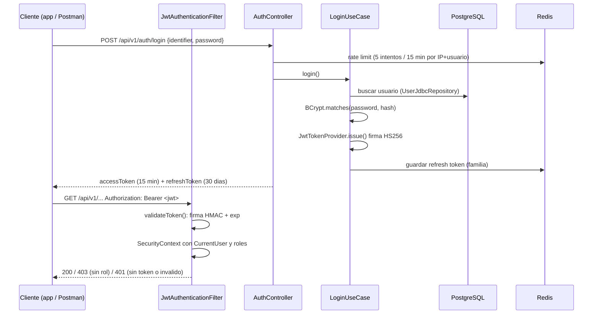

# Seguridad del backend

Autenticacion y autorizacion de `securepassb`: como funciona el JWT, que
rutas son publicas, y como se demuestra con Postman.

## Flujo de autenticacion

## Componentes

| Componente | Archivo | Que hace |
|---|---|---|
| Cadena de filtros | `shared/config/SecurityConfig.java` | Stateless, sin sesion ni form login, CORS, 401 propio, reglas por URL |
| PasswordEncoder | `SecurityConfig.passwordEncoder()` | BCrypt costo 12 |
| Emision y validacion JWT | `shared/security/JwtTokenProvider.java` | HMAC-SHA256 con `SECUREPASS_JWT_SECRET` (>= 32 bytes, falla al arrancar si falta). Valida firma en tiempo constante y `exp`. Ignora el `alg` del header: siempre HS256, asi `alg=none` no pasa |
| Filtro | `shared/security/JwtAuthenticationFilter.java` | Lee `Authorization: Bearer`, valida y carga `CurrentUser` en el `SecurityContext` |
| Usuario autenticado | `shared/security/CurrentUser.java`, `AccessGuard.java` | `userId`, barrio, roles y lotes salen del token, nunca del body |
| Login | `modules/identity/application/LoginUseCase.java` | Busca usuario, verifica BCrypt, emite access + refresh |
| Refresh con rotacion | `RefreshTokenUseCase.java` + `RedisRefreshTokenStore.java` | Cada refresh da uno nuevo; reusar uno viejo revoca toda la familia |
| Autorizacion por rol | `@PreAuthorize` en controllers | `hasRole('ADMIN')`, permisos por lote (`@lotPerm`) |

### Por que no hay `UserDetailsService`

`UserDetailsService` es el puerto que usa Spring cuando el framework hace el
login (form login, HTTP Basic, `AuthenticationManager`). Aca el login es un
caso de uso propio (`LoginUseCase`) y cada request se autentica con el JWT,
sin volver a la base. El equivalente:

| Concepto Spring | En este proyecto |
|---|---|
| `UserDetailsService.loadUserByUsername` | `UserRepository.findByIdentifier` |
| `UserDetails` | `CurrentUser` (record) |
| `AuthenticationManager` | `LoginUseCase.login` |

## Rutas

| Ruta | Acceso |
|---|---|
| `/api/v1/auth/**`, `/api/v1/activation/**`, `/activar/**` | Publica |
| `/actuator/health/**`, `/actuator/info` | Publica (probes de Azure Container Apps) |
| `/actuator/metrics`, `/actuator/prometheus` | Solo `PLATFORM_ADMIN` |
| `/v3/api-docs/**`, `/swagger-ui/**` | Publica |
| Todo lo demas | JWT valido; el rol lo exige cada endpoint |

401 = sin token o token invalido/vencido (el cliente intenta refresh).
403 = token valido sin el rol (no refresca).

## Anotaciones de Spring usadas

| Anotacion | Ejemplo real | Para que |
|---|---|---|
| `@Configuration` | `SecurityConfig.java:29` | Clase que declara beans |
| `@Bean` | `SecurityConfig.filterChain`, `passwordEncoder` | Metodo cuyo retorno Spring registra como singleton |
| `@Component` | `JwtAuthenticationFilter.java:19` | Bean generico detectado por escaneo |
| `@Service` | `JwtTokenProvider.java:24`, `LoginUseCase.java:16` | Igual que `@Component`, marca logica de servicio |
| `@Autowired` | No se usa en `src/main` | Inyeccion por constructor (regla del repo). Lombok `@AllArgsConstructor` genera el constructor (`LoginUseCase.java:15`). Solo aparece en tests |
| `@Entity` / `@Table` / `@Column` | `neighborhood/infrastructure/persistence/LotEntity.java:25-54` | Mapeo JPA. El resto de la persistencia usa `JdbcClient` con parametros nombrados |
| `@Transactional` | `access/application/ConsumeAccessUseCase.java:34` | Todo el caso de uso en una transaccion |
| `@Override` | `JwtAuthenticationFilter.doFilterInternal` | Sobrescribe `OncePerRequestFilter` |
| `@PreAuthorize` | `AuthController`, `InvitationController` | Autorizacion por rol a nivel metodo |
| `@Profile("dev")` | `tools/DevSeedRunner.java:34` | Bean que solo existe con el perfil `dev` |

Patrones: cada `@Bean`/`@Service` es un **Singleton** administrado por el
contenedor de Spring. No se agrego un Builder artificial; los DTO son `record`.

## Demostracion con Postman

Coleccion: `docs/postman/securepassb-jwt.postman_collection.json`.

1. Postman > Import > elegir el archivo.
2. Levantar el backend local (ver README) o cambiar `baseUrl` a la URL de Azure
   en las variables de la coleccion.
3. Click derecho en la coleccion > Run collection > Run.

| # | Prueba | Esperado |
|---|---|---|
| 01 | Health sin token | 200 `UP` |
| 02 | Login con password mala | 401, sin token |
| 03 | Login correcto | 200; JWT de 3 partes, `alg` HS256, rol ADMIN, `exp - iat = expiresIn` |
| 04 | Endpoint protegido sin token | 401 |
| 05 | Mismo endpoint con token | 200 |
| 06 | Token con payload cambiado a PLATFORM_ADMIN | 401 (la firma no coincide) |
| 07-08 | Guardia en endpoint de admin | 403 |
| 09 | Titular lista invitaciones | 200, todo del barrio del token |
| 10 | Refresh | 200, refresh token nuevo |
| 11 | Reusar el refresh viejo | 401, familia revocada |
| 12-14 | `/actuator/prometheus` sin token / admin / plataforma | 401 / 403 / 200 |

Expiracion: arrancar con `SECUREPASS_JWT_TTL_SECONDS=60`, correr 03, esperar
60 s y correr 05: 401.

Resultado verificado en local (2026-10-11): 23/23 aserciones con Newman, y
expiracion con TTL 5 s: 200 a los 0 s, 401 a los 6 s.

Desde la terminal, sin abrir Postman: `npx newman run docs/postman/securepassb-jwt.postman_collection.json`.
