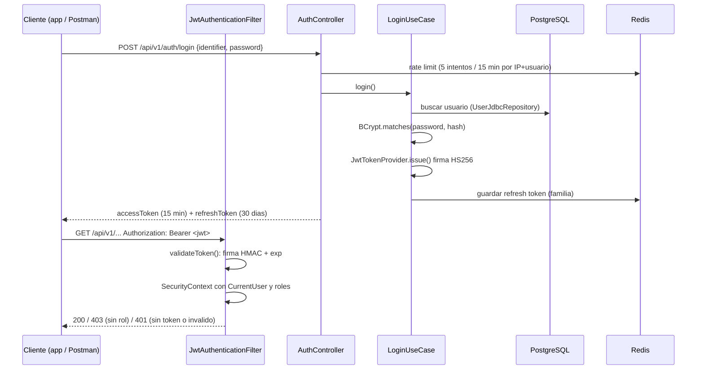

# Seguridad del backend

Autenticacion y autorizacion de `securepassb`: como funciona el JWT, que
rutas son publicas, y como se demuestra con Postman.

## Flujo de autenticacion



## Componentes

| Componente | Archivo | Que hace |
|---|---|---|
| Cadena de filtros | `shared/config/SecurityConfig.java` | Stateless, sin sesion ni form login, CORS, 401 propio, reglas por URL |
| PasswordEncoder | `SecurityConfig.passwordEncoder()` | BCrypt costo 12 |
| Emision y validacion JWT | `shared/security/JwtTokenProvider.java` | HMAC-SHA256 con `SECUREPASS_JWT_SECRET` (>= 32 bytes, falla al arrancar si falta). Valida firma en tiempo constante y `exp`. Ignora el `alg` del header: siempre HS256, asi `alg=none` no pasa |
| Filtro | `shared/security/JwtAuthenticationFilter.java` | Lee `Authorization: Bearer`, valida y carga `CurrentUser` en el `SecurityContext` |
| Usuario autenticado | `shared/security/CurrentUser.java`, `AccessGuard.java` | `userId`, barrio, roles y lotes salen del token, nunca del body |
| Login | `modules/identity/application/LoginUseCase.java` | Busca usuario, verifica BCrypt, emite access + refresh |
| Refresh con rotacion | `RefreshTokenUseCase.java` + `RedisRefreshTokenStore.java` | Cada refresh da uno nuevo; reusar uno viejo revoca toda la familia |
| Autorizacion por rol | `@PreAuthorize` en controllers | `hasRole('ADMIN')`, permisos por lote (`@lotPerm`) |

### Por que no hay `UserDetailsService`

`UserDetailsService` es el puerto que usa Spring cuando el framework hace el
login (form login, HTTP Basic, `AuthenticationManager`). Aca el login es un
caso de uso propio (`LoginUseCase`) y cada request se autentica con el JWT,
sin volver a la base. El equivalente:

| Concepto Spring | En este proyecto |
|---|---|
| `UserDetailsService.loadUserByUsername` | `UserRepository.findByIdentifier` |
| `UserDetails` | `CurrentUser` (record) |
| `AuthenticationManager` | `LoginUseCase.login` |

## Rutas

| Ruta | Acceso |
|---|---|
| `/api/v1/auth/**`, `/api/v1/activation/**`, `/activar/**` | Publica |
| `/actuator/health/**`, `/actuator/info` | Publica (probes de Azure Container Apps) |
| `/actuator/metrics`, `/actuator/prometheus` | Solo `PLATFORM_ADMIN` |
| `/v3/api-docs/**`, `/swagger-ui/**` | Publica |
| Todo lo demas | JWT valido; el rol lo exige cada endpoint |

401 = sin token o token invalido/vencido (el cliente intenta refresh).
403 = token valido sin el rol (no refresca).

## Anotaciones de Spring usadas

| Anotacion | Ejemplo real | Para que |
|---|---|---|
| `@Configuration` | `SecurityConfig.java:29` | Clase que declara beans |
| `@Bean` | `SecurityConfig.filterChain`, `passwordEncoder` | Metodo cuyo retorno Spring registra como singleton |
| `@Component` | `JwtAuthenticationFilter.java:19` | Bean generico detectado por escaneo |
| `@Service` | `JwtTokenProvider.java:24`, `LoginUseCase.java:16` | Igual que `@Component`, marca logica de servicio |
| `@Autowired` | No se usa en `src/main` | Inyeccion por constructor (regla del repo). Lombok `@AllArgsConstructor` genera el constructor (`LoginUseCase.java:15`). Solo aparece en tests |
| `@Entity` / `@Table` / `@Column` | `neighborhood/infrastructure/persistence/LotEntity.java:25-54` | Mapeo JPA. El resto de la persistencia usa `JdbcClient` con parametros nombrados |
| `@Transactional` | `access/application/ConsumeAccessUseCase.java:34` | Todo el caso de uso en una transaccion |
| `@Override` | `JwtAuthenticationFilter.doFilterInternal` | Sobrescribe `OncePerRequestFilter` |
| `@PreAuthorize` | `AuthController`, `InvitationController` | Autorizacion por rol a nivel metodo |
| `@Profile("dev")` | `tools/DevSeedRunner.java:34` | Bean que solo existe con el perfil `dev` |

Patrones: cada `@Bean`/`@Service` es un **Singleton** administrado por el
contenedor de Spring. No se agrego un Builder artificial; los DTO son `record`.

## Demostracion con Postman

Coleccion: `docs/postman/securepassb-jwt.postman_collection.json`.

1. Postman > Import > elegir el archivo.
2. Levantar el backend local (ver README) o cambiar `baseUrl` a la URL de Azure
   en las variables de la coleccion.
3. Click derecho en la coleccion > Run collection > Run.

| # | Prueba | Esperado |
|---|---|---|
| 01 | Health sin token | 200 `UP` |
| 02 | Login con password mala | 401, sin token |
| 03 | Login correcto | 200; JWT de 3 partes, `alg` HS256, rol ADMIN, `exp - iat = expiresIn` |
| 04 | Endpoint protegido sin token | 401 |
| 05 | Mismo endpoint con token | 200 |
| 06 | Token con payload cambiado a PLATFORM_ADMIN | 401 (la firma no coincide) |
| 07-08 | Guardia en endpoint de admin | 403 |
| 09 | Titular lista invitaciones | 200, todo del barrio del token |
| 10 | Refresh | 200, refresh token nuevo |
| 11 | Reusar el refresh viejo | 401, familia revocada |
| 12-14 | `/actuator/prometheus` sin token / admin / plataforma | 401 / 403 / 200 |

Expiracion: arrancar con `SECUREPASS_JWT_TTL_SECONDS=60`, correr 03, esperar
60 s y correr 05: 401.

Resultado verificado en local (2026-10-11): 23/23 aserciones con Newman, y
expiracion con TTL 5 s: 200 a los 0 s, 401 a los 6 s.

Desde la terminal, sin abrir Postman: `npx newman run docs/postman/securepassb-jwt.postman_collection.json`.

## Analisis de seguridad: estatico, dependencias e imagen

Tres herramientas, tres preguntas distintas:

| | CodeQL | Grype / Trivy | gitleaks |
|---|---|---|---|
| Tipo | **SAST**: analisis estatico del codigo fuente | **SCA** + escaneo de imagen: componentes de terceros con CVE conocidos | Busqueda de secretos en el historial de git |
| Que mira | Nuestro codigo: como fluyen los datos desde una entrada HTTP hasta una consulta SQL, un archivo, un log | Las versiones de librerias Java y paquetes Debian dentro de la imagen | Todos los commits, buscando claves, tokens, passwords |
| Detecta | Inyeccion SQL, path traversal, XSS, deserializacion insegura, regex vulnerables, secretos hardcodeados, permisos de workflows | CVE publicados (con su CVSS) en dependencias que no escribimos | Credenciales commiteadas por error |
| No detecta | Vulnerabilidades en librerias de terceros | Errores de logica en nuestro codigo | Vulnerabilidades |
| Cuando corre | `codeql.yml`: push, PR, los lunes | `backend-ci.yml` (job image) en cada build | A mano antes de publicar el repo |

CodeQL es analisis **estatico**: lee el codigo, no lo ejecuta, y no bloquea
nada en runtime. Que CodeQL no encuentre inyeccion SQL significa que no hay
un camino de un dato externo a un SQL sin parametrizar; la proteccion real
la dan las consultas parametrizadas.

### CodeQL (`.github/workflows/codeql.yml`)

Lenguajes: Java (observando la compilacion real con Gradle), Python
(`scripts/`) y los workflows de GitHub Actions. Set de reglas
`security-extended`. Resultados: repo > **Security** > **Code scanning**.

Resultado (2026-10-12, PR #23): **0 alertas** (Java 120 reglas, Python 50,
Actions 23).

Requisito: code scanning es gratis en repos publicos; en privados necesita
GitHub Code Security (pago). Por eso `acr-securepassb` se hizo publico.

### gitleaks antes de publicar el repo

```powershell
docker run --rm -v "${PWD}:/repo" zricethezav/gitleaks:latest git /repo --redact
```

Resultado (2026-10-12): 213 commits, 17 coincidencias, **todas falsos
positivos**: el placeholder de `.env.example` y de los tests (en base64 dice
`DEV_ONLY_KEY_32_BYTES_XXXXXXXXXX`), un texto de test que dice
`no-es-un-cifrado-valido-para-esta-clave`, y ejemplos truncados de tokens en
`spec.md`. Los secretos de produccion nunca estuvieron en el repo.

Con el repo publico tambien son publicos los logs de Actions y los artifacts
(informes de Grype): muestran nombres de recursos y la URL; los secretos
aparecen enmascarados como `***`.

### Revision manual

| Punto | Estado | Donde |
|---|---|---|
| Consultas parametrizadas | Todas las consultas usan parametros con nombre (`:nid`, `:lots`). Los `WHERE` dinamicos concatenan solo fragmentos constantes, nunca datos del usuario | `*JdbcRepository`, `AccessLogJdbcQuery.java` |
| Validacion de entrada | `@Valid` en 30 endpoints, records con `@NotBlank`, `@Email`; el dominio valida invariantes en el constructor | Controllers, `domain/` |
| Manejo de errores | Errores como `application/problem+json`; un error inesperado devuelve `"Error interno"` sin stack trace ni mensaje interno | `GlobalExceptionHandler.java` |
| Informacion sensible | Actuator: solo health e info publicos; metricas solo para `PLATFORM_ADMIN`. Logs JSON sin passwords; el link de activacion no se loguea | `SecurityConfig.java`, `NeighborhoodProvisioningCli.java` |
| Secretos | Por variable de entorno; en Azure como secretos de la Container App; GitHub solo tiene `AZURE_CREDENTIALS` | `docs/azure.md` |
| Dockerfile | Multietapa, sin shell ni gestor de paquetes (glibc-dynamic), usuario `nobody`, `.dockerignore` allowlist, descarga del agente con hash fijo | `Dockerfile`, `docs/docker.md` |
| Dependencias | Spring Boot 3.5.16 + parches; gate de Grype en el CI | `build.gradle.kts`, `docs/vulnerabilidades.md` |
| Transporte | HTTPS obligatorio (Azure redirige HTTP con 301); Postgres con TLS obligatorio | `docs/azure.md` |

### Pendiente conocido: links de activacion en los logs

Con `SECUREPASS_EMAIL_PROVIDER=logging` (el default; no hay proveedor de
email configurado en Azure), `LoggingEmailSender` escribe el cuerpo del
email en el log, link de activacion incluido. En Azure eso llega a Log
Analytics y Application Insights.

- Alcance: solo leen esos logs los que administran el workspace (el duenio
  de la suscripcion y el Service Principal).
- Mitigacion actual: cada link es de un solo uso y vence; las cuentas de
  prueba se activaron apenas se crearon (reusar el link da 410).
- Solucion: configurar el proveedor real que ya soporta el backend
  (`SECUREPASS_EMAIL_PROVIDER=resend`, `RESEND_API_KEY` como secreto de la
  Container App, dominio verificado). No se cambio la logica de la app.
